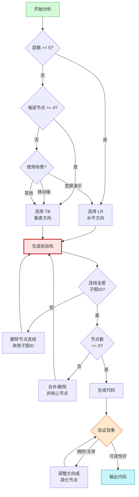
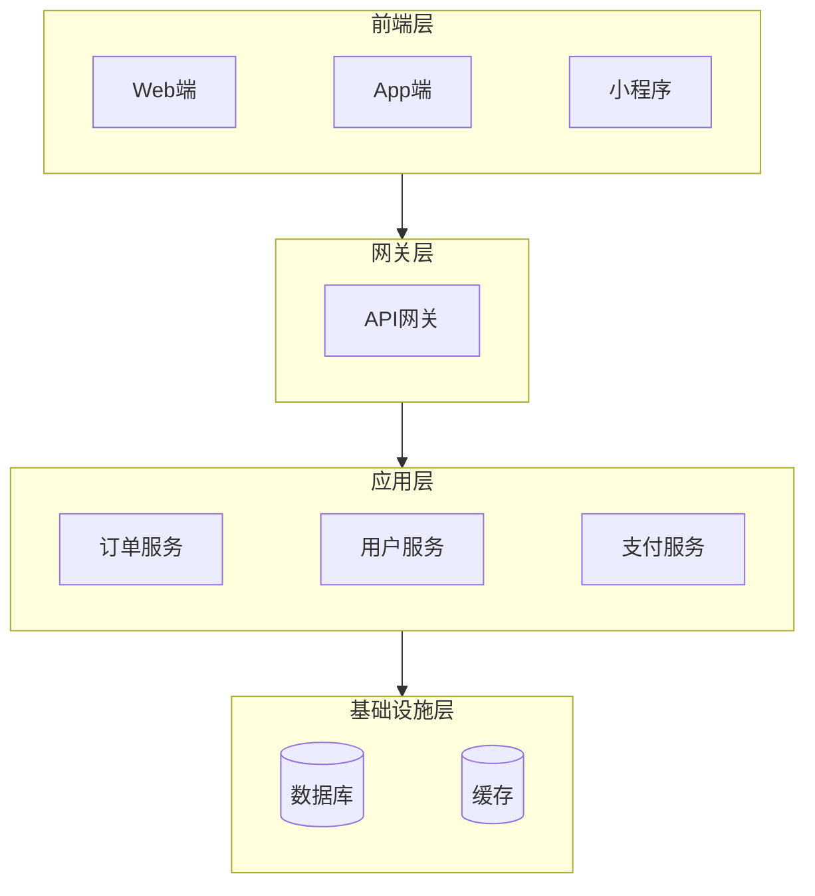
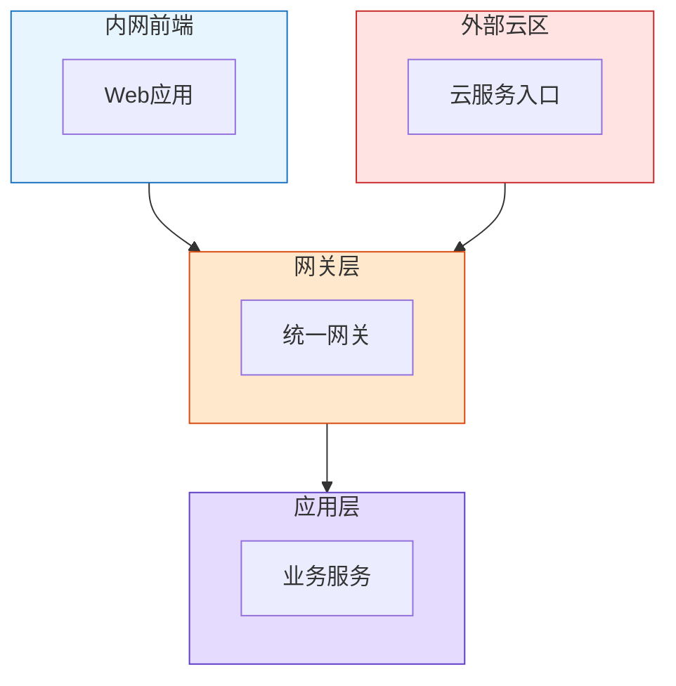
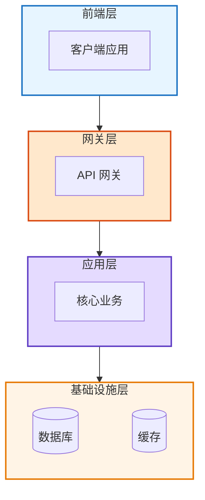
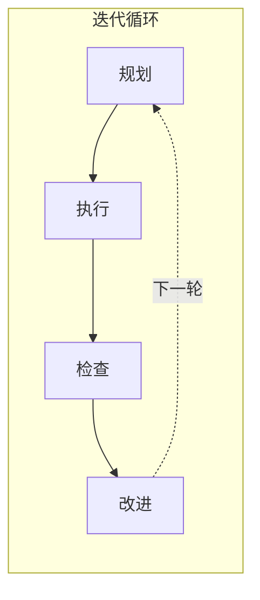
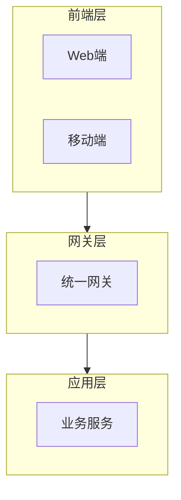
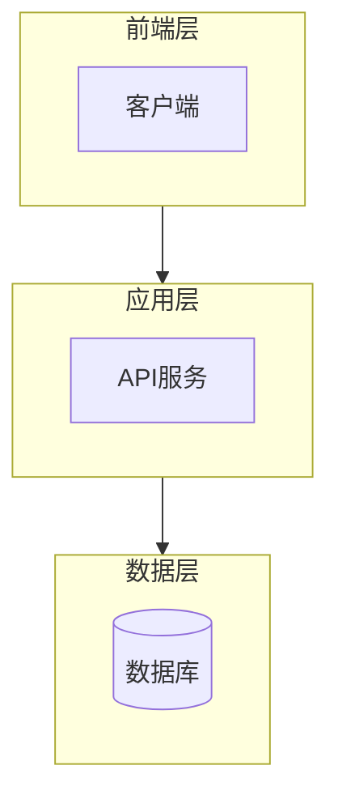

# 架构图分层与排版规范

**核心问题**：架构图排版混乱、连线过多、跨层交叉。本文档提供智能排版策略与关键约束，生成前必须检查。

---

## 📋 快速参考卡片

### 生成流程
```
分析内容 → 选择方向 → 编写代码 → 验证效果 → 输出
```

### 方向选择速查
| 特征 | 方向 | 备注 |
|-----|------|-----|
| 层数 ≥ 5 | LR | 避免过高 |
| 每层节点 ≥ 4 | TB | 避免过宽 |
| 移动端 | TB | 竖屏友好 |
| 宽屏演示 | LR | 大屏展示 |
| 不确定 | TB | 默认选择 |

### 四大关键约束
1. **子图ID连接**：`FE --> GW`，❌ 禁止 `Client --> API`
2. **节点 3-5 个**：只画核心，辅助系统省略或虚线
3. **连线 ≤ 8 条**：超限则聚合为层级连线
4. **单向拓扑**：禁止逆向实线，回调用虚线 `-.->`

---

### 🚨 黄金法则（绝对禁止）

```
❌ 严禁出现任何节点到节点的连线！
   如：JISService --> Eureka
       Gateway --> Eureka
       App --> Apollo
       
✅ 只允许子图到子图的连线！
   如：APP --> INFRA
       GW & EXT --> APP
```

**架构图是分层抽象视图，不是组件调用图！**

---

## 一、智能排版策略

### 1. 排版决策流程图



### 2. 生成前强制自检

**在写任何代码之前，必须回答以下问题**：

| 问题 | 答案 | 如果不符合怎么办 |
|-----|------|----------------|
| 连线是否全是子图ID？（如 `FE --> GW`） | 必须是 | ❌ 删除所有 `节点 --> 节点` 的连线 |
| 是否存在 `JISService --> Eureka` 这类？ | 绝对不能有 | ❌ 改为 `APP -.-> INFRA` 层级概括 |
| 核心节点数是否 ≤ 5？ | 必须 ≤ 5 | ❌ 删除/合并非核心服务 |
| 是否想画"谁调用谁"？ | 这是调用图，不是架构图 | ❌ 切换到调用图思维，只画层级流 |

**自检口诀**：
```
写代码前先检查：
- 没有 A --> B（节点→节点）
- 只有 FE --> GW（子图→子图）
- 服务注册/配置/日志，全部用虚线概括
- 数据持久化主线，一条实线就够
```

### 3. 方向选择参考

| 内容特征 | 推荐方向 | 原因 |
|---------|---------|-----|
| 层数 ≥ 5 层 | `LR`（水平） | 垂直会太高，阅读困难 |
| 每层节点 ≥ 4 个 | `TB`（垂直） | 水平会太宽，不易对齐 |
| 移动端优先场景 | `TB` | 手机屏幕竖屏友好 |
| 宽屏演示场景 | `LR` | 适合投影、大屏展示 |
| 层级深度 > 宽度 | `TB` | 深度优先的内容 |
| 层级宽度 > 深度 | `LR` | 广度优先的内容 |

**默认策略**：无特殊要求时，优先使用 `TB`（垂直），符合常规阅读习惯。

### 4. 混合布局模式（外层纵向 + 子层横向）

**场景**：当某一层内部有多个并行组件时，可以让子层水平展开，整体仍保持纵向层级流。



**用法说明**：
- 外层主方向：`graph TB`（纵向层级关系）
- 子图内部：`direction LR`（横向排列同层节点）
- 分隔同层节点：使用 `~~~`（不可见连线）保持间距

⚠️ **防折行天条（强制）**：
> 在 `direction LR` 的子图中，**必须使用且只能使用 `~~~` 串联所有并行节点**（如 `A ~~~ B ~~~ C`），**严禁使用换行符或分行写法**。
> 
> 这强制约束 Mermaid 引擎将所有节点锁死在同一水平线上，物理撑开架构图的整体宽度，避免图表过窄。
> 
> ```
> ✅ 正确：单行串联，强制横向展开
>     Web[Web端] ~~~ App[App端] ~~~ Mini[小程序]
> 
> ❌ 错误：换行导致节点上下堆叠，横向拉不开
>     Web[Web端]
>     App[App端]
>     Mini[小程序]
> ```

**适用场景**：
| 场景 | 推荐布局 | 原因 |
|-----|---------|-----|
| 每层有 3-5 个并行服务 | 外层 TB + 子层 LR | 纵向浏览层级，横向对比同层组件 |
| 展示技术栈组成 | 外层 TB + 子层 LR | 清晰展示各层技术选型 |
| 模块划分清晰 | 外层 TB + 子层 LR | 层级关系 + 模块内聚同时表达 |

### 5. 生成后验证清单

生成代码后，验证以下问题：

- [ ] **是否太挤？** 节点文字是否重叠？连线是否交叉过多？
  - **解决**：切换方向（TB ↔ LR）或减少每层节点数
  
- [ ] **是否太窄/太高？** 图中大片空白？比例失调？
  - **解决**：切换方向或调整子图内节点排列（`direction LR` 或 `direction TB`）
  
- [ ] **子图是否对齐？** 各层起始位置参差不齐？
  - **解决**：使用 `~~~` 不可见连线调整占位，或简化节点内容
  
- [ ] **整体可读性如何？** 一眼能看出层级关系？
  - **解决**：如不满意，尝试另一种方向重新生成

### 6. 优化示例

**场景：生成了一个 6 层架构图，发现垂直方向太挤**

```
问题：TB 方向导致图太高，需要大量滚动才能看全
决策：改为 LR 水平方向
验证：水平展开后，宽度适中，阅读流畅
```

**场景：应用层有 5 个服务，水平排列导致太宽**

```
问题：LR 方向下应用层节点并排太宽
决策1：应用层内部改为垂直排列（subgraph 内用 direction TB）
决策2：或改为 TB 主方向
验证：选择最优方案
```

**场景：混合布局下某层节点太多导致横向溢出**

```
问题：应用层横向排列 6 个服务，太宽
决策1：改为 TB 主方向（全纵向）
决策2：或拆分为两个子层（核心业务 + 支撑服务）
决策3：或简化为 3-5 个代表节点
验证：选择最清晰可读的方案
```

---

## 二、方向一致性原则

### 1. 一图一向原则

- **整张图必须具备统一的演进方向**
- **默认采用垂直向下流向**：`graph TB`，除非分析后确定水平更优
- **禁止混用方向**：同一图中不得出现部分垂直、部分水平的主流向

```
✅ 正确：全部自上而下
graph TB
    FE --> GW --> APP --> INFRA

✅ 正确：全部自左而右（当层数多时推荐）
graph LR
    FE --> GW --> APP --> INFRA

❌ 错误：方向混乱
graph TB
    FE --> GW
    GW --> APP
    APP --> FE  ← 逆向，拓扑被破坏
```

### 2. 结构对齐原则

- 所有子图（`subgraph`）应在相同的水平线或垂直线上对齐
- 避免层级错位、逻辑层跨越、局部斜向排版

```
✅ 正确：层级水平对齐
subgraph L1["前端层"]
    Client[客户端]
end

subgraph L2["网关层"]
    Gateway[API网关]
end

subgraph L3["应用层"]
    Service[业务服务]
end

FE --> GW --> APP

❌ 错误：层级错位、参差不齐
（子图起始位置不在同一水平线，影响视觉层次感）
```

---

## 三、四大关键约束

**违反以下任一条，架构图将失去清晰性。**

---

### 约束一：必须使用外层子图ID连接（强制）

**核心原则**：层级之间的连线必须使用外层 `subgraph` 的 ID，**绝对禁止**使用子图内部的实体节点 ID。

**🚨 AI 最常犯的错误**：
```
❌ 错误：把架构图画成组件调用图！

JISService -->|服务注册| Eureka       ← 节点→节点，严禁！
Gateway -->|服务发现| Eureka         ← 节点→节点，严禁！
App -->|配置获取| Apollo            ← 节点→节点，严禁！
AdminApp -->|配置获取| Apollo        ← 节点→节点，严禁！
JISService -->|数据持久化| DB         ← 节点→节点，严禁！
Docker -->|部署| K8S                ← 节点→节点，严禁！
```

**✅ 正确的抽象画法**：
```
APP -.->|服务注册/发现| INFRA      ← 子图→子图，单条虚线概括
APP -.->|配置获取| INFRA           ← 子图→子图，单条虚线概括
APP -->|数据持久化| INFRA          ← 子图→子图，数据流主线
INFRA -.->|部署| INFRA             ← 基础设施内部自循环
```

**根本区别**：
- 组件调用图：展示"谁调用了谁"（实现细节）
- 架构分层图：展示"数据从哪层流向哪层"（抽象视图）

```
✅ 正确：使用子图 ID 连接（抽象层级关系）
FE --> GW
GW --> APP
APP --> INFRA

❌ 错误：使用内层实体节点 ID 连接（变成组件调用图）
Client --> API
API --> CoreBiz
CoreBiz --> DB

❌ 更错误：混合使用（方向也乱了）
Client --> GW
FE --> API
```

**为什么必须这样做？**
- 子图代表一个"层级"或"模块"，层级之间的连接应该是"层 → 层"
- 使用内层节点会让读者误以为是"具体组件 → 具体组件"，丢失了分层架构的抽象意义
- 子图连接能在视觉上清晰展示"数据从哪一层流向哪一层"

---

### 约束二：严禁微服务点对点交叉

**问题场景**：后端服务层与基础设施层之间，每个服务单独拉线到每个数据库。

```
❌ 失败示例（连线爆炸）：
UserService --> UserDB
UserService --> Redis
OrderService --> OrderDB
OrderService --> Redis
PayService --> PayDB
PayService --> Redis
（3服务 × 3存储 = 9条线，变成蜘蛛网）

✅ 正确做法：聚合为层级连线（使用子图ID）
FE --> GW --> APP --> INFRA

说明：层级之间的连接应使用子图ID，而非内部节点ID
```

**聚合策略**：
| 原始连线数 | 处理方式 |
|-----------|---------|
| ≤ 4 条 | 可保留细粒度子图ID连线 |
| 5-8 条 | 使用子图ID合并：`FE & GW --> APP` |
| > 8 条 | 强制聚合为子图ID连接（`FE --> INFRA`） |

**联合声明语法（`&`）示范**：

当多个入口子图同时指向同一个下游子图时，使用 `&` 语法合并连线：



**适用场景**：
- 内网 + 外部云区共同接入网关
- 多个前端渠道汇聚到同一入口
- 微服务网关聚合路由

---

### 约束三：严禁全量罗列

**核心原则**：只画出代表核心业务逻辑的 **3-5 个主节点**。

**必须从图中省略或虚线示意的辅助节点**：
- 监控系统（Prometheus、Grafana、Datadog）
- 日志收集（ELK、Loki、Fluentd）
- 配置中心（Nacos、Apollo、Consul）
- 分布式锁（Redis、Zookeeper、etcd）
- 服务注册（Eureka、Nacos）
- 消息队列（非核心业务流可省略）

**例外**：用户明确要求展示某个辅助系统时，可用虚线 `-.->` 示意，但不拉入主线。

```
✅ 正确：只画核心流（使用子图ID连接）
FE --> GW --> APP --> INFRA

❌ 错误：所有组件都画（且使用节点ID）
Client --> API --> CoreBiz --> DB
CoreBiz -.-> Redis
CoreBiz -.-> Kafka
CoreBiz -.-> Prometheus
CoreBiz -.-> ELK
API -.-> Nacos
（辅助系统抢戏，主线被淹没，且违反子图ID连接规则）
```

---

### 约束四：严格遵守单向拓扑

**核心原则**：图形整体流向必须保持绝对的 **自上而下** 或 **自左向右**。

**逆向连线的处理**：

| 场景 | ❌ 错误做法 | ✅ 正确做法 |
|-----|-----------|-----------|
| 回调机制 | `FE --> APP --> FE` | `FE --> APP`，在 APP 处注释"完成后回调 FE" |
| 注册/订阅 | `FE --> APP --> FE` | `FE --> APP`，虚线 `APP -.->|事件| FE` |
| 循环反馈 | `FE --> APP --> INFRA --> FE` | 用虚线反馈：`INFRA -.->|反馈| FE`，或拆图为循环图 |

```
✅ 正确：回调用虚线示意（子图ID连接），不破坏主线
FE --> APP
APP -.->|异步回调| FE

❌ 错误：实线逆向，拓扑被破坏
FE --> APP --> FE
```

**注意**：如果业务逻辑本质是循环的（如持续改进流程），请使用 [循环图模式](#循环图模式) 而非架构图。

---

## 四、强制审查流程

**在输出架构图代码之前，必须完成以下检查：**

### 第一步：连线计数检查

数一数你准备画几条线：

| 连线数 | 判定 | 处理 |
|-------|-----|------|
| ≤ 4 条 | ✅ 继续 | 使用子图ID连接即可 |
| 5-8 条 | ⚠️ 警告 | 考虑使用 `FE & GW --> APP` 合并子图ID连线 |
| > 8 条 | 🛑 停止 | 强制聚合为子图ID连接（`FE --> INFRA`） |

### 第二步：拓扑合规检查

- [ ] 层级连线是否全部使用子图ID？（禁止使用内层节点ID）
- [ ] 【前端层】是否只指向【网关层/单一入口】？
- [ ] 【应用层】是否只通过统一通道指向【基础层】？
- [ ] 是否存在跨层交叉拉线？（如有，全部删掉）
- [ ] 是否存在逆向实线？（如有，改为虚线或注释）

### 第三步：双引号防爆过滤器

**检查所有节点的显示文本，防止渲染崩溃。**

**🚨 强制规则：以下情况必须用双引号包裹**

**最容易遗漏（最常出错）：**
| 场景 | 示例 | 正确写法 | ❌ 错误写法 |
|-----|------|---------|------------|
| **空格** ⚠️ | API 网关 | `GW["API 网关"]` | ~~`GW[API 网关]`~~ |
| **中文冒号** | 服务：用户 | `Svc["服务：用户"]` | ~~`Svc[服务：用户]`~~ |
| **竖线** | MySQL｜共享 | `DB["MySQL｜共享"]` | ~~`DB[MySQL｜共享]`~~ |

> **自检口诀**：只要节点文本包含**空格**或**任何中文标点**，必须加双引号！

**检查清单（强制）**：
- [ ] **所有**包含空格的节点文本已加双引号？
- [ ] 所有包含 `｜` `：` `+` 的文本已加双引号？
- [ ] 子图显示名已用 `id["显示名"]` 格式？

```
✅ 正确：特殊字符用双引号包裹
DB["MySQL｜共享Schema：jmbos_jis_application"]

❌ 错误：未加双引号，渲染崩溃
DB[MySQL｜共享Schema：jmbos_jis_application]
```

**三项检查全部通过后，方可输出代码。**

---

## 五、分层架构模板

### 标准四层架构



### 分层命名对照表

| 层级 | 常用命名 |
|-----|---------|
| 前端层 | 客户端、Web端、移动端、用户界面、前端应用 |
| 网关层 | API网关、认证中心、负载均衡、入口网关、BFF |
| 应用层 | 核心业务、业务服务、领域服务、应用服务、微服务集群 |
| 基础设施层 | 数据库、缓存、消息队列、存储、数据存储中心 |

---

## 六、常见错误与修正

| 错误现象 | 根因 | 修正方法 |
|---------|-----|---------|
| 使用内层节点ID连接层级 | 违反约束一 | 改用子图ID：`FE --> GW --> APP --> INFRA` |
| 前端A/B/C各自连线到后端1/2/3，蜘蛛网 | 入口未收敛 | 前端层 → API网关（单一入口）→ 应用层 |
| 每个微服务都画出来，10+个节点 | 未做聚合 | 同职责服务合并为"业务模块"，只画 3-5 个代表 |
| 所有依赖都画线（含日志、监控、配置） | 未区分主次 | 只画核心数据流，辅助系统省略或虚线示意 |
| 前端直接连数据库 | 跨层连线 | 严格分层，每层只指向相邻下一层 |
| 回调用实线逆向 | 拓扑被破坏 | 改为虚线 `-.->` 或文字注释说明 |

---

## 七、特殊情况处理

### 循环图模式

当业务本质是迭代循环时，不要用架构图，改用循环图：



### 多入口场景

如果系统有多个入口（如Web + 移动端），可以：



**注意**：多入口在子图内部，层间连接仍使用子图ID。网关之后必须收敛为单线。

### 简化架构（无网关场景）

某些轻量级架构可能没有独立网关层：



此时前端层可直接连接应用层，网关层非必须。

---

## 八、最终检查清单

画完架构图，过这个清单：

- [ ] 层级连线全部使用子图ID（`FE --> GW`），禁止使用内层节点ID（`Client --> API`）
- [ ] 方向统一（全部 TB 或全部 LR）
- [ ] 子图层级水平对齐
- [ ] 连线总数 ≤ 8 条
- [ ] 只有 3-5 个核心节点
- [ ] 辅助系统已省略或虚线
- [ ] 无跨层直接连线
- [ ] 无逆向实线
- [ ] 入口已收敛（前端 → 网关）

全部通过才算合格。
