# 类图 (Class Diagram)

类图用于展示面向对象系统的类结构、属性、方法以及类之间的关系，是系统设计和架构文档化的重要工具。

## 使用场景

| 场景 | 说明 |
|------|------|
| 系统架构设计 | 展示核心业务模型和领域对象 |
| 代码结构可视化 | 将代码中的类关系图形化呈现 |
| 设计模式说明 | 展示模式中的参与者及其关系 |
| API 设计文档 | 展示数据模型和DTO结构 |
| 数据库映射 | 展示实体类与表结构的对应关系 |
| 遗留系统分析 | 梳理现有系统的类层次结构 |

## 基础语法

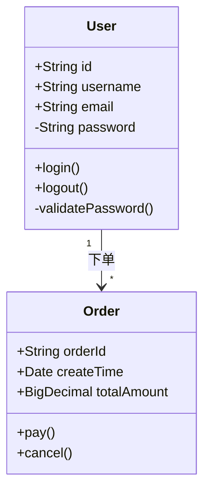

## 语法规则详解

### 1. 类定义

**基本格式：**
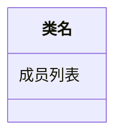

**成员可见性：**

| 符号 | 可见性 | 说明 |
|------|--------|------|
| `+` | public | 公开访问 |
| `-` | private | 私有访问 |
| `#` | protected | 受保护访问 |
| `~` | package/default | 包级访问 |

**成员类型：**

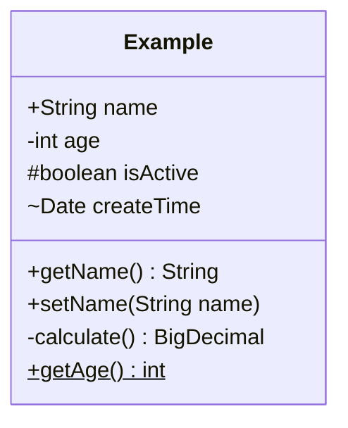

### 2. 类关系

#### 继承（Inheritance）

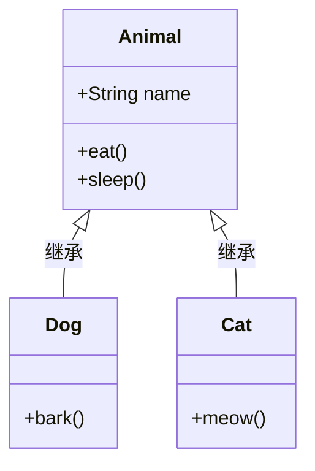

- 语法：`父类 <|-- 子类`
- 箭头指向父类，表示子类继承父类

#### 实现/实现接口（Implementation）

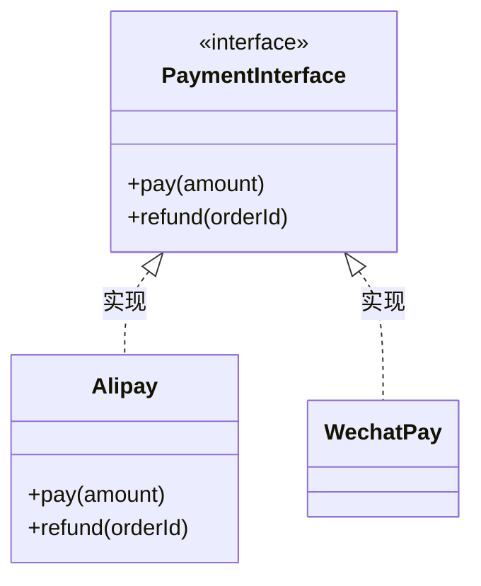

- 语法：`接口 <|.. 实现类`
- 使用虚线空心箭头表示实现关系

#### 关联（Association）

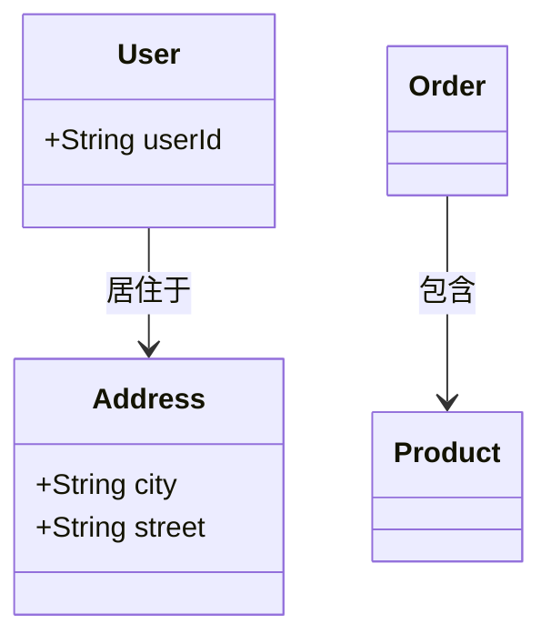

- 语法：`类A --> 类B : 关系描述`
- 表示一个类的对象知道另一个类的对象

#### 聚合（Aggregation）

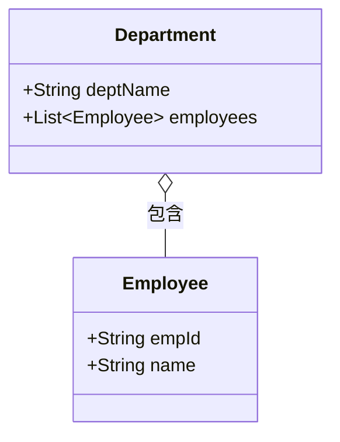

- 语法：`整体 o-- 部分`
- 空心菱形表示聚合，部分可以独立于整体存在

#### 组合（Composition）

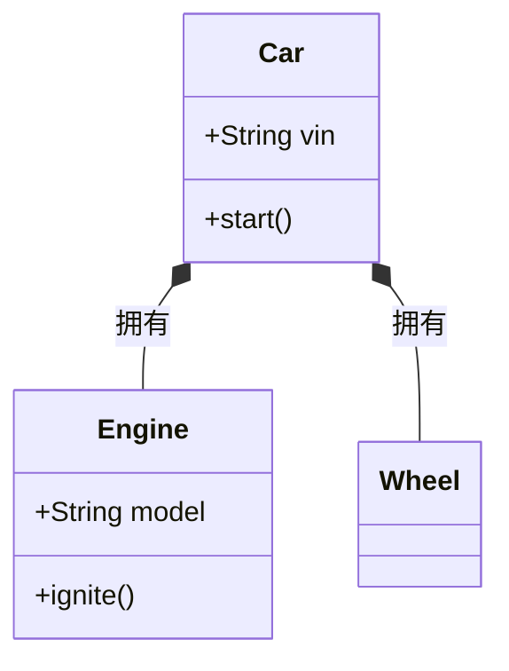

- 语法：`整体 *-- 部分`
- 实心菱形表示组合，部分不能独立于整体存在

#### 依赖（Dependency）

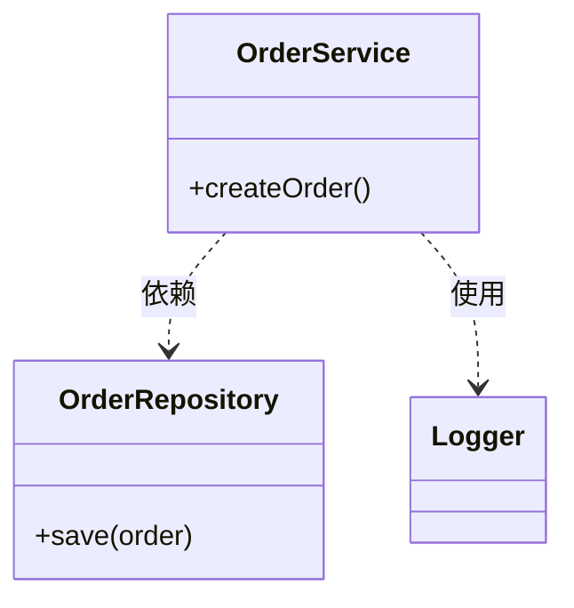

- 语法：`类A ..> 类B : 依赖描述`
- 虚线箭头表示依赖，一个类的变化可能影响另一个类

### 3. 多重性（ Cardinality/Multiplicity ）

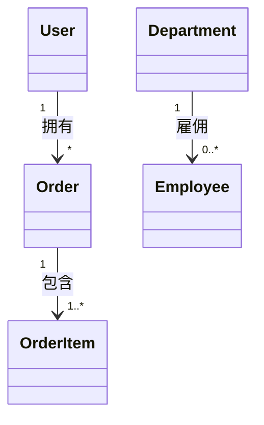

**多重性表示：**

| 写法 | 含义 |
|------|------|
| `"1"` | 必须有且只有一个 |
| `"*"` | 零个或多个 |
| `"0..1"` | 零个或一个（可选） |
| `"1..*"` | 一个或多个 |
| `"0..*"` | 等同于 `"*"` |
| `"2..5"` | 2到5个 |
| `"3"` | 必须有3个 |

**完整格式：**
```
类A "多重性A" --> "多重性B" 类B : 关系
```

### 4. 类注释与说明

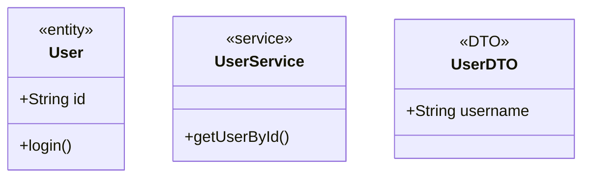

**常用构造型（Stereotype）：**

| 标记 | 含义 |
|------|------|
| `<<interface>>` | 接口 |
| `<<abstract>>` | 抽象类 |
| `<<service>>` | 服务类 |
| `<<entity>>` | 实体类 |
| `<<DTO>>` | 数据传输对象 |
| `<<repository>>` | 仓储类 |
| `<<controller>>` | 控制器 |

### 5. 匿名类与快捷定义

```mermaid
classDiagram
    <!-- 标准定义 -->
    class StandardClass {
        +method()
    }

    <!-- 仅声明类名（用于关系图） -->
    class EmptyClass

    <!-- 内联定义（简化版） -->
    InlineClass : +String name
    InlineClass : +getName()
```

## 高级特性

### 命名空间/包

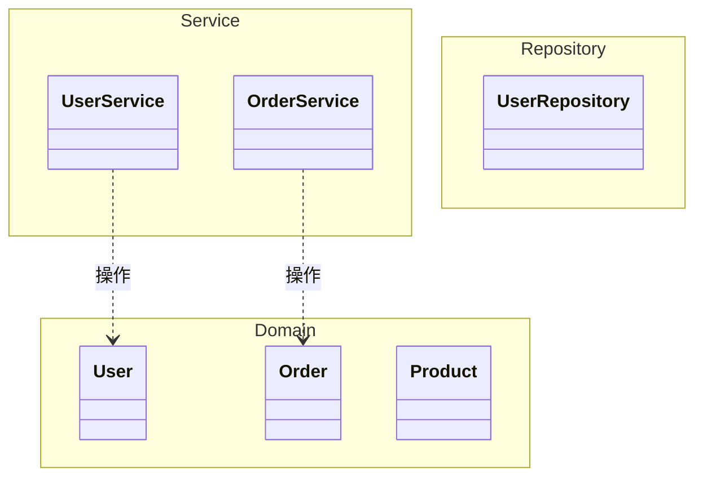

### 泛型

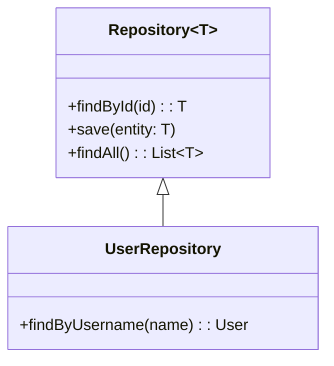

### 回调与函数类型

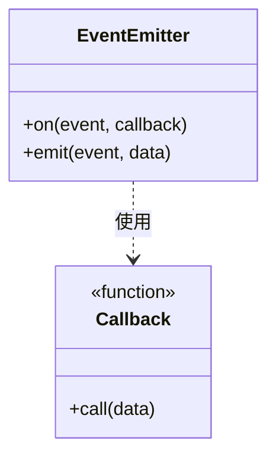

## 配色与样式

类图使用默认样式，但可以通过注释添加视觉分组：

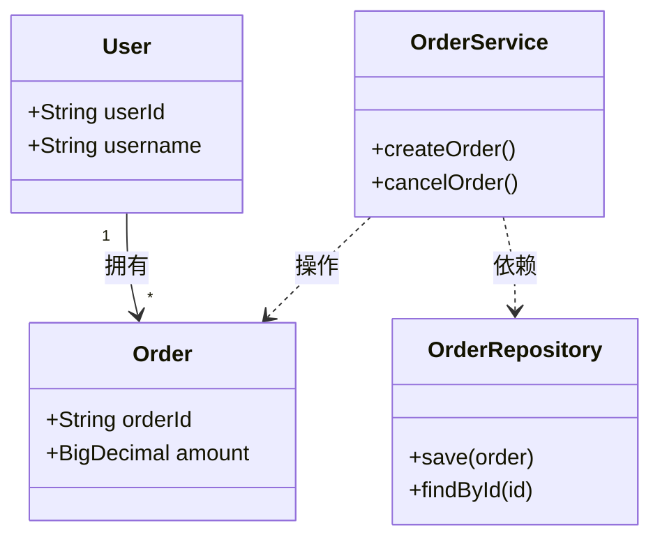

## 完整示例

### 示例1：电商系统核心模型

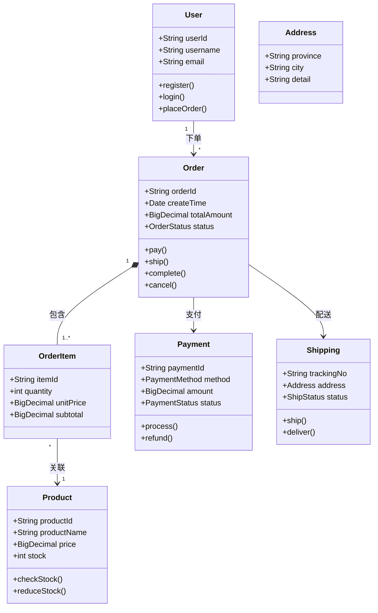

### 示例2：设计模式 - 观察者模式

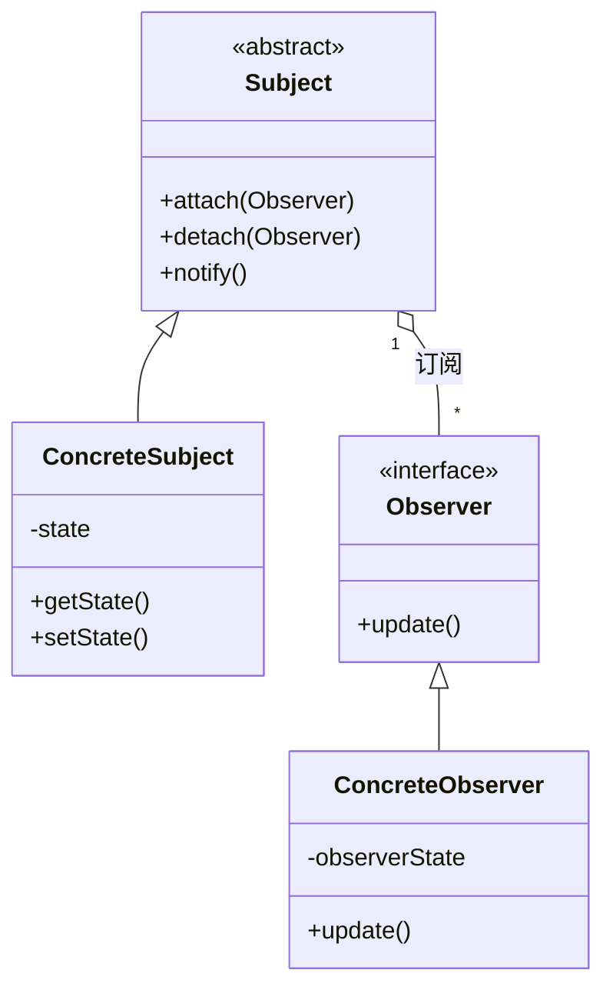

### 示例3：分层架构

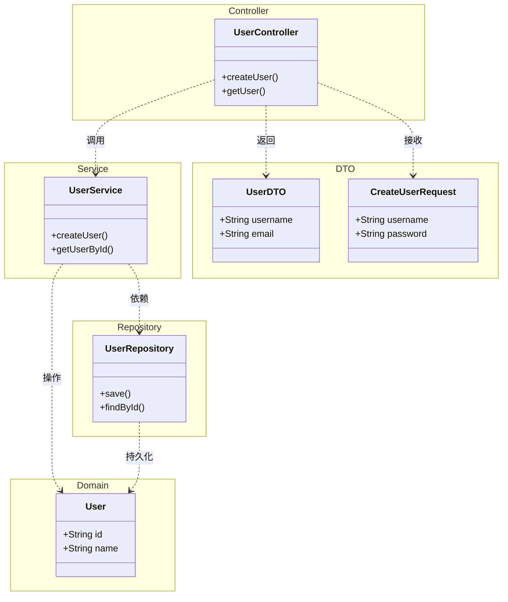

## 最佳实践

### 命名规范
- 类名使用大驼峰：`UserService`, `OrderRepository`
- 方法名使用小驼峰：`getUserById()`, `placeOrder()`
- 属性名使用小驼峰：`userName`, `createTime`

### 复杂度控制
- 单图类数量控制在 10-15 个以内
- 超过时按分层、模块或场景拆分
- 关系线避免过度交叉

### 信息层级
1. **精简视图**：仅显示类名和关键关系（ overview 用）
2. **标准视图**：类名 + 方法/属性名 + 关系（文档用）
3. **详细视图**：包含参数、返回类型、可见性（详细设计用）

### 关系选择
- **继承**：`is-a` 关系，如 `Dog is a Animal`
- **实现**：实现接口契约
- **组合**：强拥有关系，部分不能脱离整体（如人-心脏）
- **聚合**：弱拥有关系，部分可独立存在（如部门-员工）
- **关联**：知道对方的存在（如用户-订单）
- **依赖**：使用对方（如服务使用仓储）

## 常见错误

```mermaid
classDiagram
    <!-- ❌ 循环继承 -->
    A <|-- B
    B <|-- C
    C <|-- A  <!-- 理论上不允许 -->

    <!-- ❌ 多重性位置错误 -->
    User "*" --> Order  <!-- 应该是 1 -> * -->

    <!-- ❌ 类名含空格 -->
    class User Service  <!-- 应使用 UserService -->

    <!-- ❌ 成员缺少类型 -->
    class BadClass {
        +name      <!-- 应该是 +String name -->
        +getName() <!-- 返回类型建议标注 -->
    }
```

## 兼容性

- ✅ Obsidian（完美支持）
- ✅ GitHub Markdown（支持）
- ✅ GitLab
- ✅ Typora
- ⚠️ 复杂泛型语法在部分渲染器可能有差异
