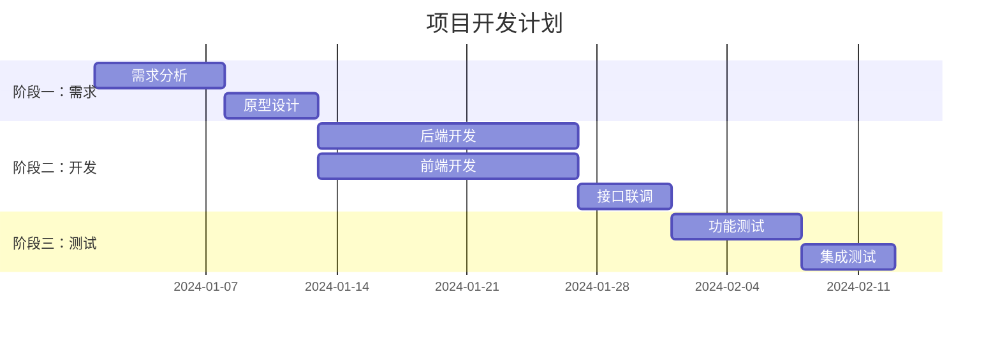
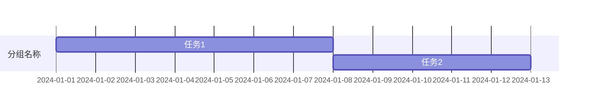
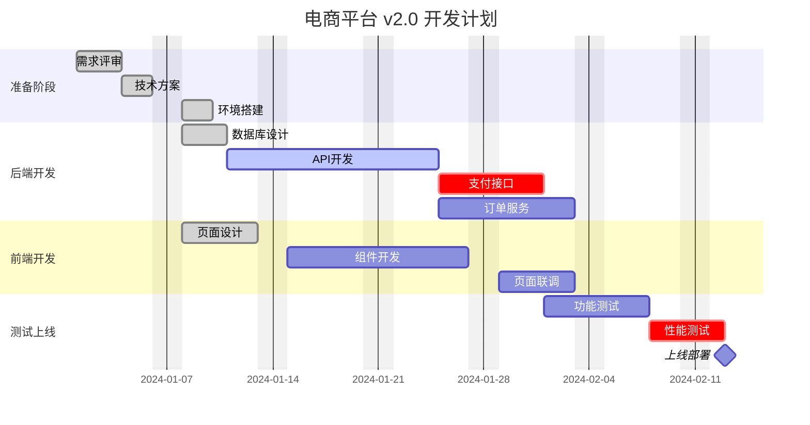

# 甘特图 (Gantt Chart)

甘特图用于展示项目任务的时间安排、进度追踪和里程碑管理。

## 使用场景

| 场景 | 说明 |
|------|------|
| 项目管理 | 展示任务起止时间、依赖关系 |
| 开发计划 | 迭代周期、版本发布时间线 |
| 里程碑追踪 | 关键节点和交付物时间 |
| 资源分配 | 多任务并行和资源冲突检查 |

## 基础语法



## 语法规则详解

### 1. 声明与标题

```mermaid
gantt
    title 图表标题
    dateFormat YYYY-MM-DD  <!-- 日期格式，必须指定 -->
```

**日期格式选项：**
- `YYYY-MM-DD` - 2024-01-15
- `DD/MM/YYYY` - 15/01/2024
- `MM-DD-YYYY` - 01-15-2024

### 2. 任务分组 (section)



- 使用 `section` 关键字创建任务分组
- 同一 section 内的任务会显示在一起
- 建议按阶段、团队或模块分组

### 3. 任务定义

**基本格式：**
```
任务名称 :任务ID, 开始时间, 持续时间
```

**各种写法：**

```mermaid
gantt
    dateFormat YYYY-MM-DD

    <!-- 方式1：指定具体日期 -->
    任务A :a1, 2024-01-01, 7d

    <!-- 方式2：依赖前置任务 -->
    任务B :a2, after a1, 5d

    <!-- 方式3：指定起止日期 -->
    任务C :2024-01-15, 2024-01-25

    <!-- 方式4：里程碑（无持续时间） -->
    里程碑M :milestone, 2024-01-30, 0d

    <!-- 方式5：活跃状态（黄色高亮） -->
    进行中任务 :active, t1, 2024-01-20, 5d

    <!-- 方式6：已完成（灰色） -->
    已完成任务 :done, t2, 2024-01-10, 3d

    <!-- 方式7：关键路径（红色） -->
    关键任务 :crit, t3, after t2, 7d

    <!-- 方式8：组合状态 -->
    关键且活跃 :crit, active, t4, after t3, 5d
    关键且完成 :crit, done, t5, 2024-01-01, 5d
```

### 4. 时间单位

| 单位 | 写法 | 示例 |
|------|------|------|
| 天 | `d` | `7d` = 7天 |
| 周 | `w` | `2w` = 2周 |
| 小时 | `h` | `8h` = 8小时 |
| 分钟 | `m` | `30m` = 30分钟 |

### 5. 任务状态标签

| 标签 | 视觉效果 | 用途 |
|------|---------|------|
| `done` | 灰色 | 已完成的任务 |
| `active` | 黄色高亮 | 当前正在进行的任务 |
| `crit` | 红色 | 关键路径任务 |
| `milestone` | 菱形标记 | 里程碑节点（无持续时间） |

**组合使用：** `crit, active` = 关键且进行中（红色高亮）

## 高级用法

### 排除非工作日

```mermaid
gantt
    title 考虑周末的项目计划
    dateFormat YYYY-MM-DD
    excludes weekends  <!-- 排除周末 -->

    section 开发
    功能开发 :2024-01-01, 10d
    <!-- 实际会跳过周末，占用14个日历日 -->
```

**排除选项：**
- `weekends` - 周六周日
- `saturdays` - 仅周六
- `sundays` - 仅周日
- `monday` - 特定星期几

### 进度百分比

```mermaid
gantt
    dateFormat YYYY-MM-DD

    部分完成的任务 :2024-01-01, 10d, 60%  <!-- 显示60%进度 -->
```

## 配色建议

甘特图使用内置颜色系统，通过状态标签控制：

| 状态 | 颜色 | 含义 |
|------|------|------|
| 默认 | 蓝色 | 普通任务 |
| active | 黄色 | 进行中 |
| done | 灰色/绿色 | 已完成 |
| crit | 红色 | 关键路径 |
| milestone | 特殊标记 | 里程碑 |

## 最佳实践

### 任务命名
- 使用动词+名词：`后端开发`、`接口联调`
- 保持简洁，控制在10字以内
- 避免特殊字符和空格（如有空格用引号包裹）

### 任务ID规则
- 简短唯一：`a1`, `b2`, `dev1`
- 有逻辑分组：`fe1`（前端1）、`be1`（后端1）
- 避免中文ID

### 时间规划
- 粒度适中：最小单位推荐半天
- 预留缓冲：关键路径后加1-2天缓冲
- 明确依赖：使用 `after id` 而非硬编码日期

### 复杂度控制
- 单图任务不超过 20 个
- Section 不超过 5 个
- 超过时拆分为多个甘特图（按阶段或模块）

## 完整示例



## 兼容性

- ✅ Obsidian（需要安装 Mermaid 插件）
- ✅ GitHub（README 和 Wiki）
- ✅ GitLab
- ✅ Typora
- ⚠️ 部分旧版本渲染器可能不支持 excludes 语法
