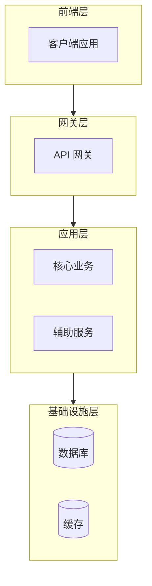
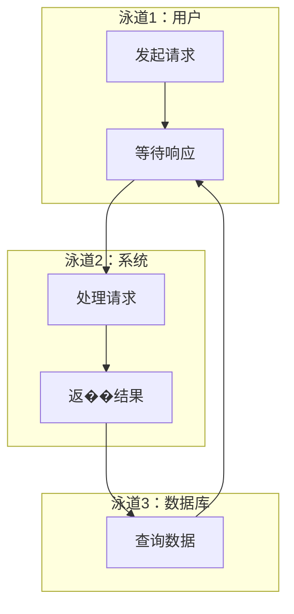
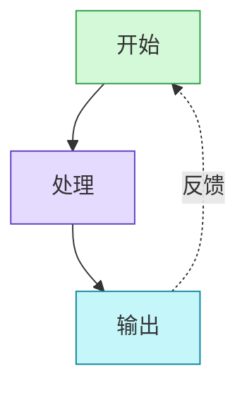
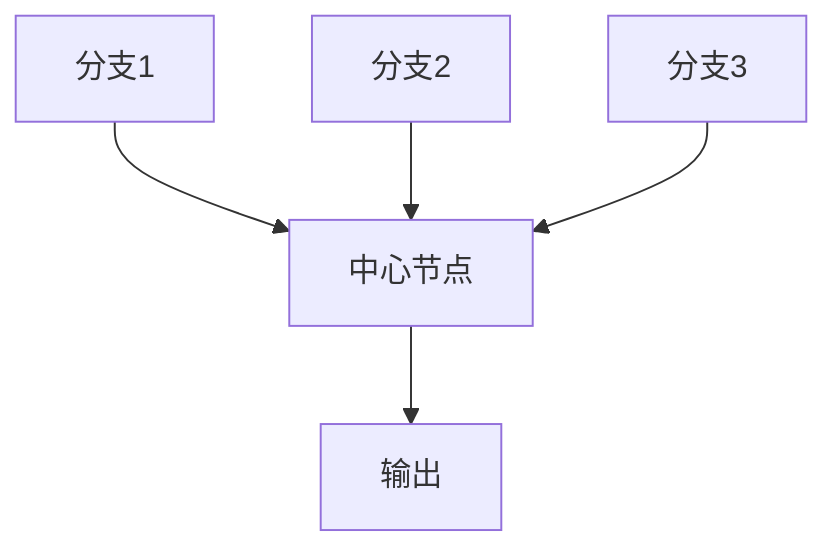
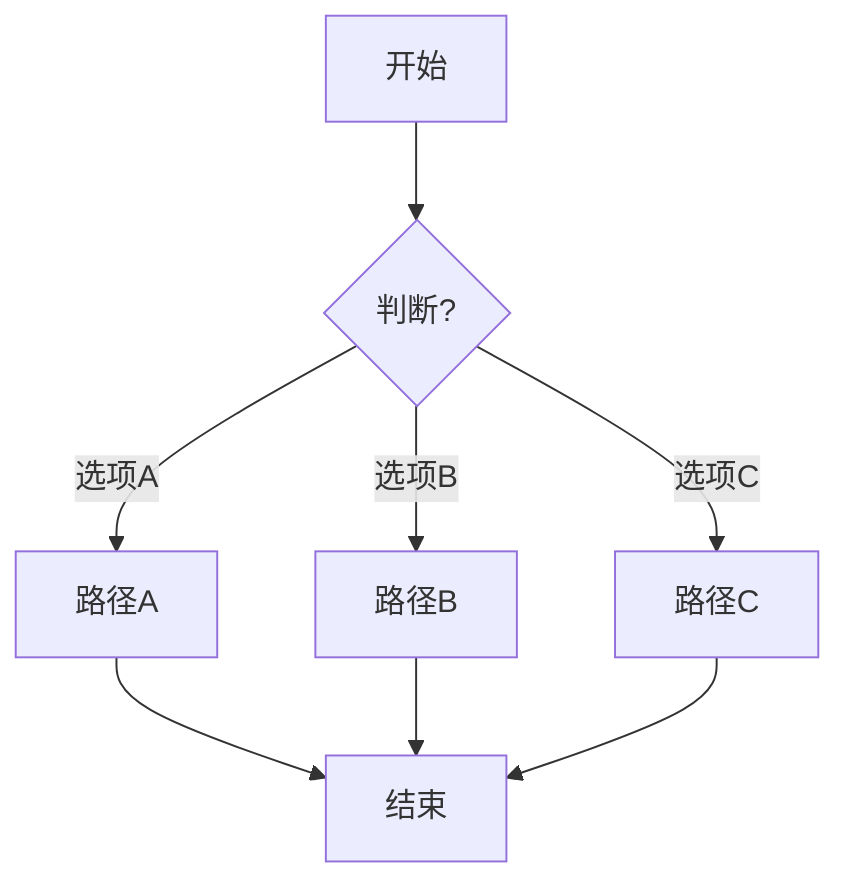
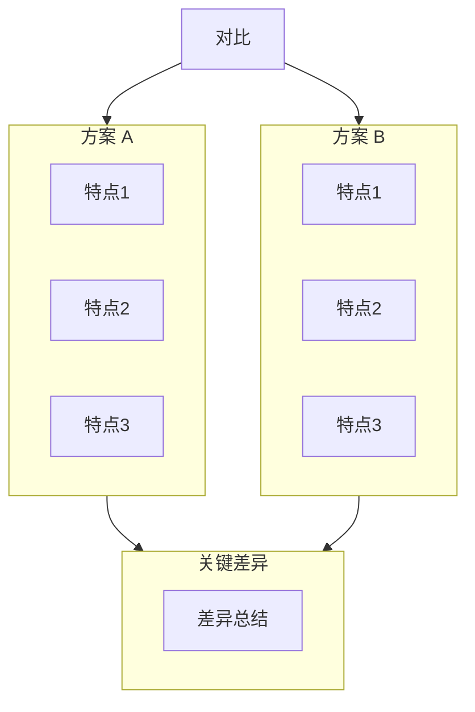
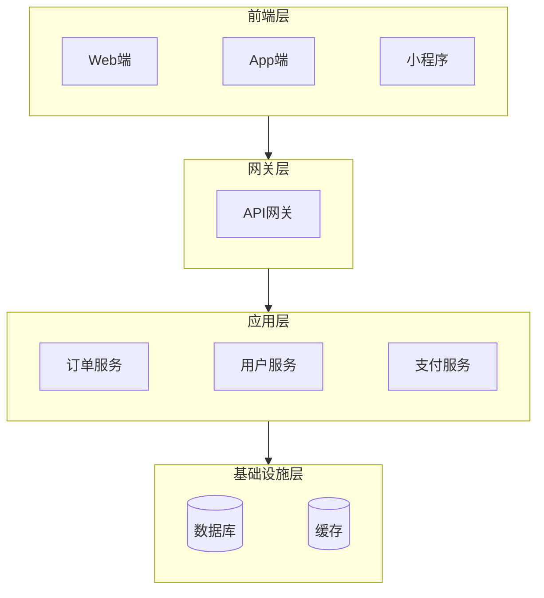

# Mermaid 布局模式参考

常用的布局模式模板，需要时查阅本文档。

---

## 架构图模式（分层结构）

> ⚠️ 架构图有严格约束，详见 [architecture-diagram.md](architecture-diagram.md)

---

## 泳道模式（分组）

适用于不同角色/部门参与的流程。

---

## 反馈循环模式

适用于有迭代反馈的场景。

---

## 中心辐射模式

适用于多分支汇聚到中心的场景。

---

## 决策树模式

适用于多分支选择的场景。

---

## 对比布局模式

适用于方案对比、前后对比等场景。

---

## 混合布局模式（外层纵向 + 子层横向）

适用于某一层内有多个并行组件的场景。

**用法说明**：
- 外层主方向：`graph TB`（纵向层级关系）
- 子图内部：`direction LR`（横向排列同层节点）
- 分隔同层节点：使用 `~~~`（不可见连线）保持间距

⚠️ **防折行天条**：在 `direction LR` 的子图中，必须用 `~~~` 串联所有节点，单行写完，禁止换行。