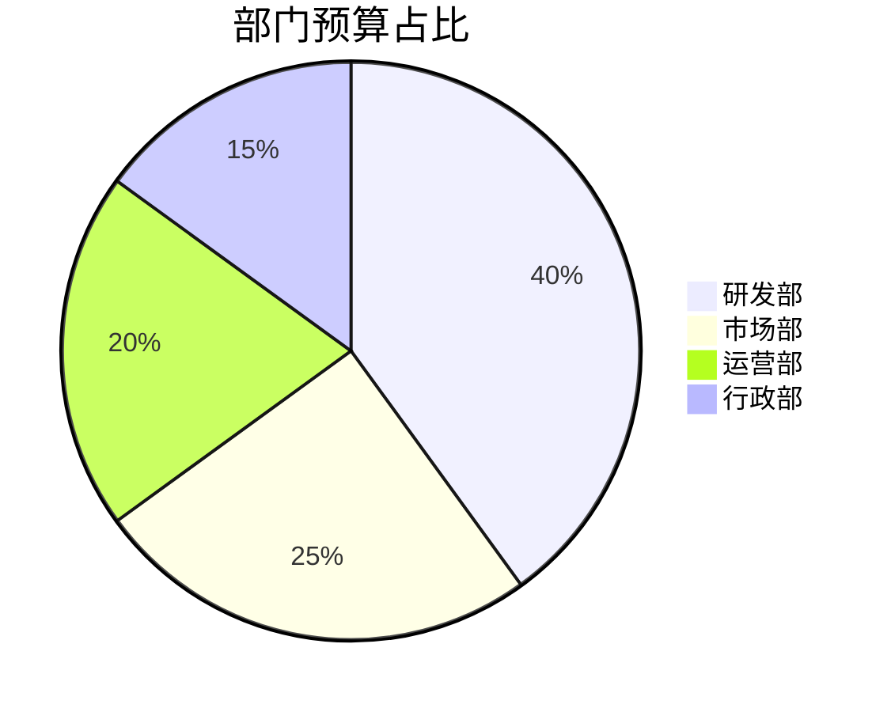
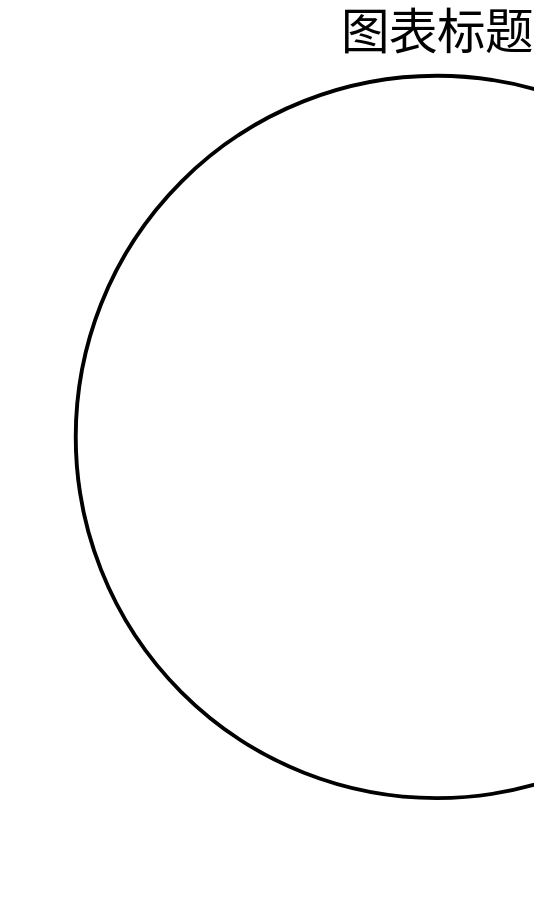
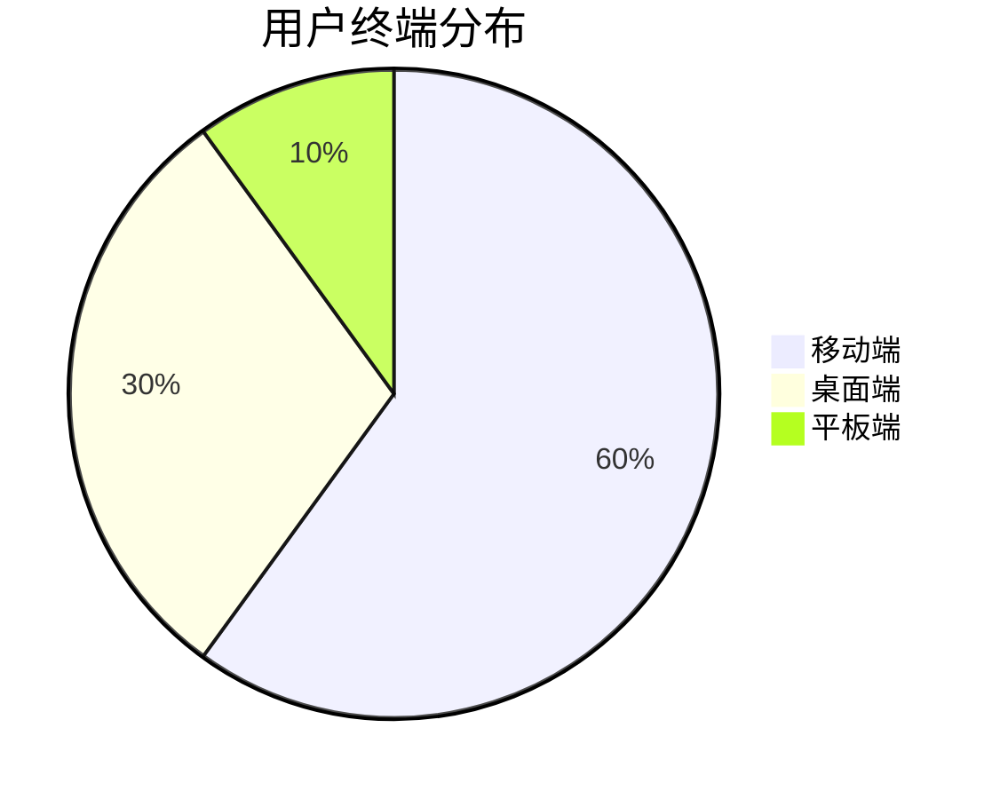
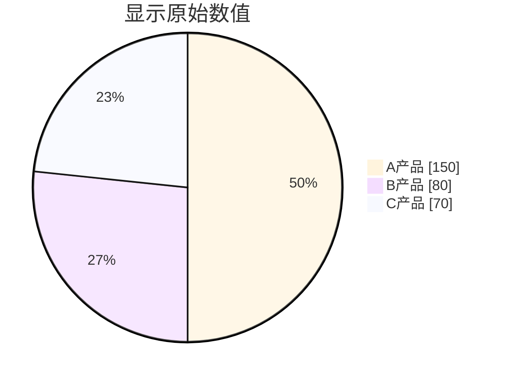
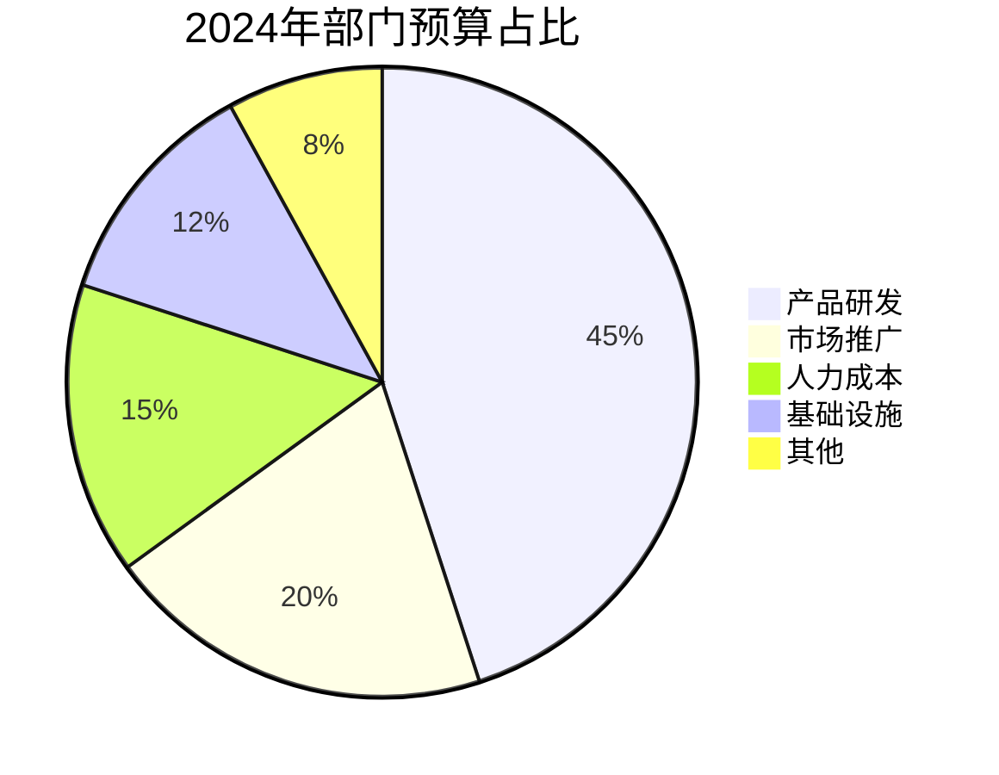
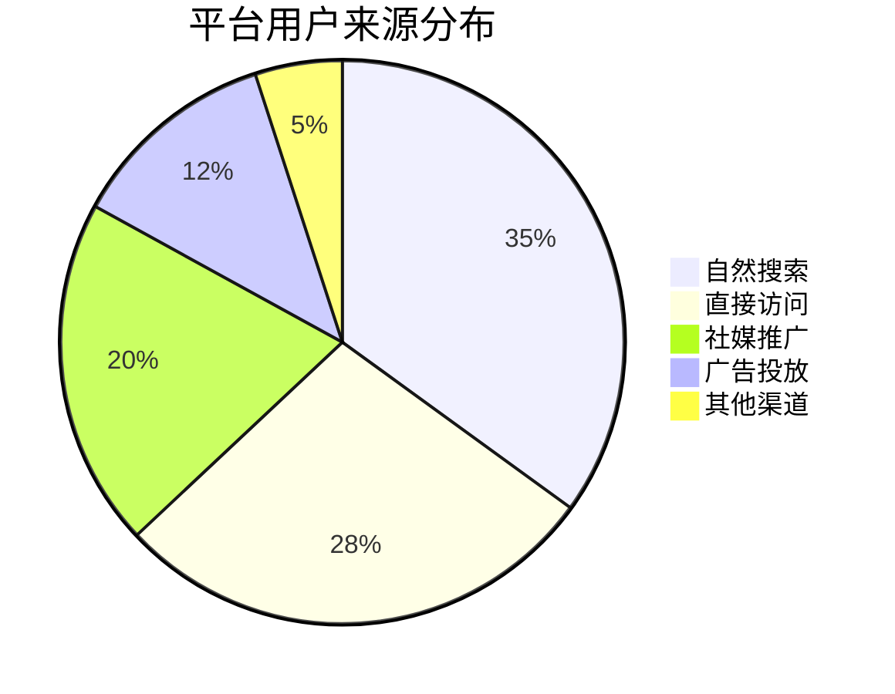
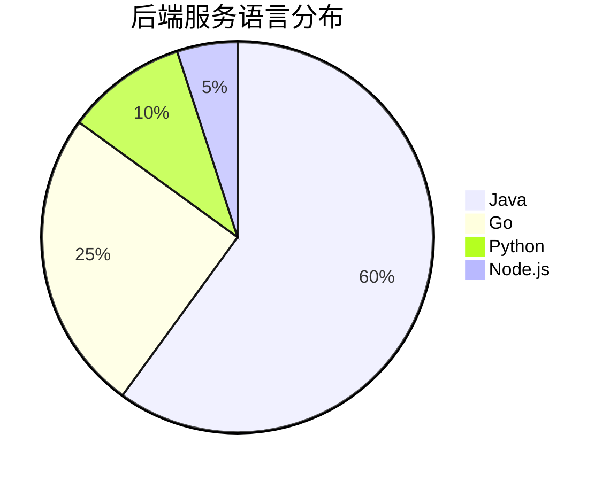

# 饼图 (Pie Chart)

饼图用于展示部分与整体的比例关系，适合展示构成、占比、分类数据。

## 使用场景

| 场景 | 说明 | 示例 |
|------|------|------|
| 占比分析 | 各部分占总体的百分比 | 预算分配、市场份额 |
| 构成展示 | 展示整体的组成部分 | 用户构成、成本结构 |
| 分类对比 | 不同类别的数值对比 | 销售渠道占比、部门人数 |
| 投票结果 | 选项得票分布 | 满意度调查、功能投票 |

## 基础语法



## 语法规则详解

### 1. 声明与标题



- `pie` 关键字开头
- `title` 可选，用于添加图表标题
- 标题有空格时用引号包裹：`title "2024年预算分配"`

### 2. 数据定义

**基本格式：**
```
"标签名称" : 数值
```

**示例：**



### 3. 标签规则


**标签最佳实践：**
- 控制在 8 个字符以内
- 使用通用简称：`iOS` 而非 `苹果移动操作系统`
- 如有空格必须用双引号包裹

### 4. 数值规则


**数值特性：**
- 支持整数和小数
- 不需要总和为 100，会自动计算百分比
- 支持 0 值（会显示标签但占比很小）
- 负数会被忽略或报错

### 5. 数据项数量


**数量建议：**
| 数据项 | 处理方式 |
|--------|---------|
| 1-2 项 | 太少，建议用文本描述 |
| 3-5 项 | 最佳范围，清晰易读 |
| 6-8 项 | 可接受，注意标签长度 |
| 9+ 项 | 过多，建议合并或使用其他图表 |

## 高级用法

### 显示数值（可选语法）



> 注意：`showData` 语法在部分渲染器中可能不支持

### 配色方案

饼图使用 Mermaid 内置配色，按顺序分配颜色：

| 序号 | 默认颜色 | 建议用途 |
|------|---------|---------|
| 第1项 | 蓝色 | 最大占比 |
| 第2项 | 橙色 | 次要占比 |
| 第3项 | 绿色 | 第三项 |
| 第4项 | 红色 | 警示/注意项 |
| 第5项+ | 紫/粉/灰 | 其他类别 |

**数据排序建议：**


## 与其他图表的对比选择

| 场景 | 推荐图表 | 原因 |
|------|---------|------|
| 3-5 个类别的占比 | **饼图** | 直观展示部分与整体关系 |
| 超过 8 个类别 | **条形图** | 避免饼图过于拥挤 |
| 需要精确比较数值 | **柱状图** | 更容易判断大小差异 |
| 时间趋势变化 | **折线图** | 展示变化趋势 |
| 多维度对比 | **思维导图** | 展示层级关系 |

## 最佳实践

### 数据准备
1. **筛选重要项**：小众数据（<5%）合并为"其他"
2. **合理排序**：按从大到小或业务重要性排序
3. **确保互斥**：各分类之间不能有重叠
4. **完整覆盖**：总和应代表完整的总体

### 标签设计
1. **简洁明了**：使用用户熟悉的术语
2. **避免歧义**：标签应指向清晰的类别
3. **考虑百分比显示**：部分渲染器自动显示百分比

### 使用场景判断

**适合使用饼图：**
- ✅ 数据项在 3-7 个之间
- ✅ 需要强调"部分占整体"的概念
- ✅ 类别之间差异明显

**不适合使用饼图：**
- ❌ 类别过多（>8个）
- ❌ 类别数值相近难以区分
- ❌ 需要精确比较大小
- ❌ 展示时间序列变化

## 完整示例

### 示例1：预算分配



### 示例2：用户构成



### 示例3：技术栈占比



### 示例4：问题分类（带"其他"合并）


## 常见错误


## 兼容性

- ✅ Obsidian（完美支持）
- ✅ GitHub Markdown（支持）
- ✅ GitLab
- ✅ Typora
- ⚠️ 部分旧版本 Mermaid 可能渲染样式略有差异

## 替代方案

当饼图不适合时，可考虑：

```mermaid
<!-- 用思维导图展示分类 -->
mindmap
  root((组成部分))
    A类[40%]
    B类[30%]
    C类[20%]
    D类[10%]

<!-- 用流程图展示占比关系 -->
graph LR
    Total[总体 100%] --> A[A类 40%]
    Total --> B[B类 30%]
    Total --> C[C类 20%]
    Total --> D[D类 10%]
```
