# Mermaid 常用模板参考

常用图表类型的模板代码，需要时查阅本文档。

---

## 架构图模板

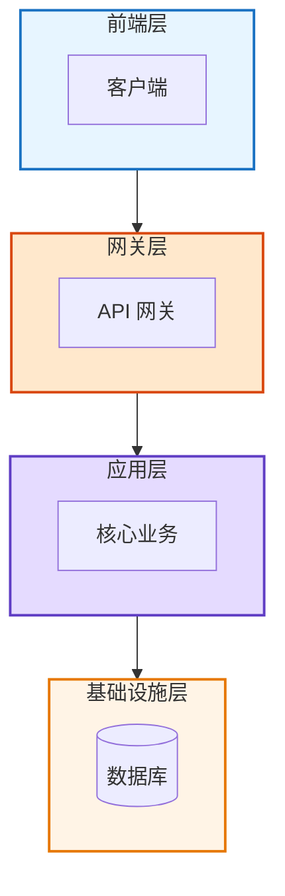

> ⚠️ 架构图有严格约束，详见 [architecture-diagram.md](architecture-diagram.md)

---

## 流程图模板

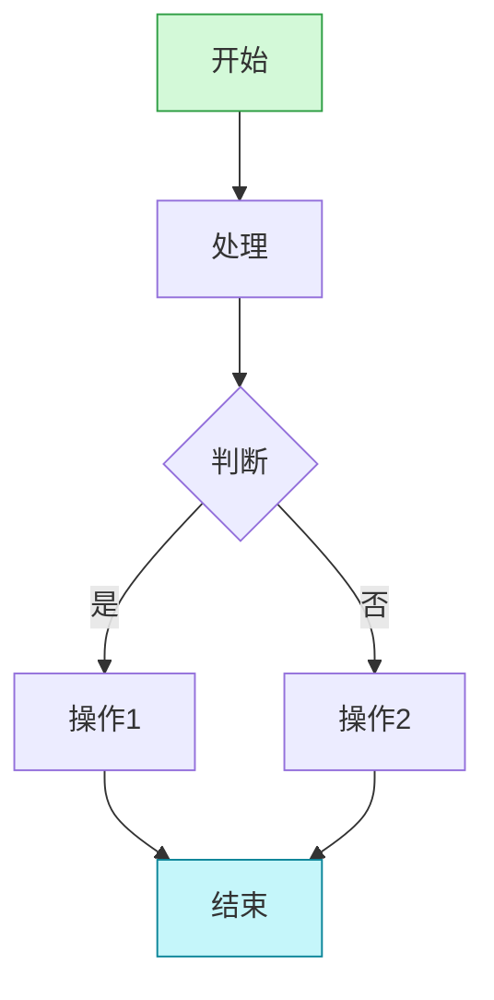

---

## 时序图模板

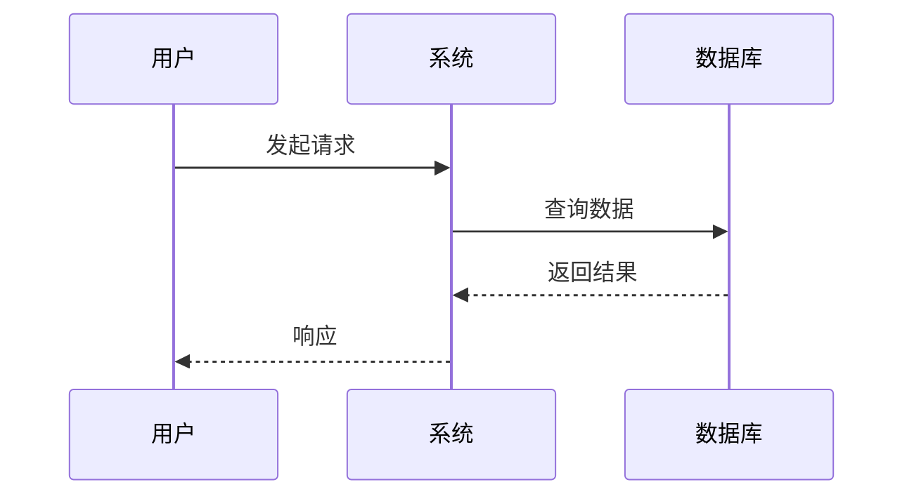

---

## 状态图模板

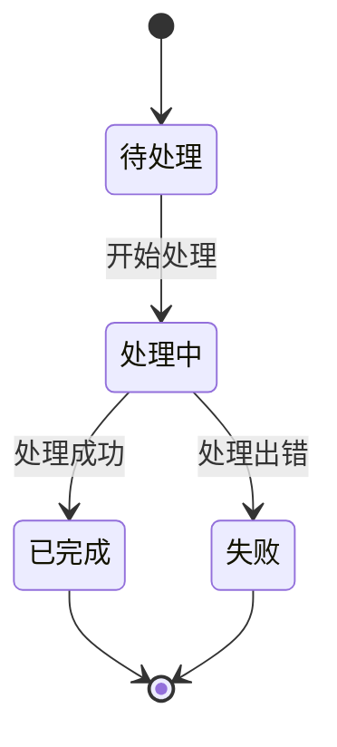

---

## 思维导图模板

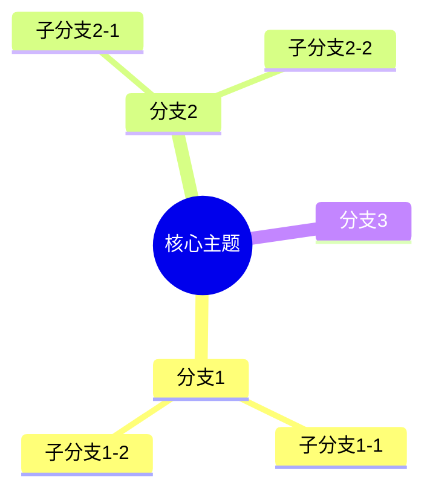

---

## 循环图模板

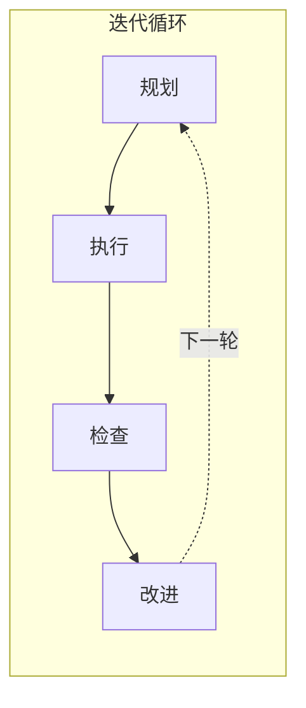

---

## 对比图模板

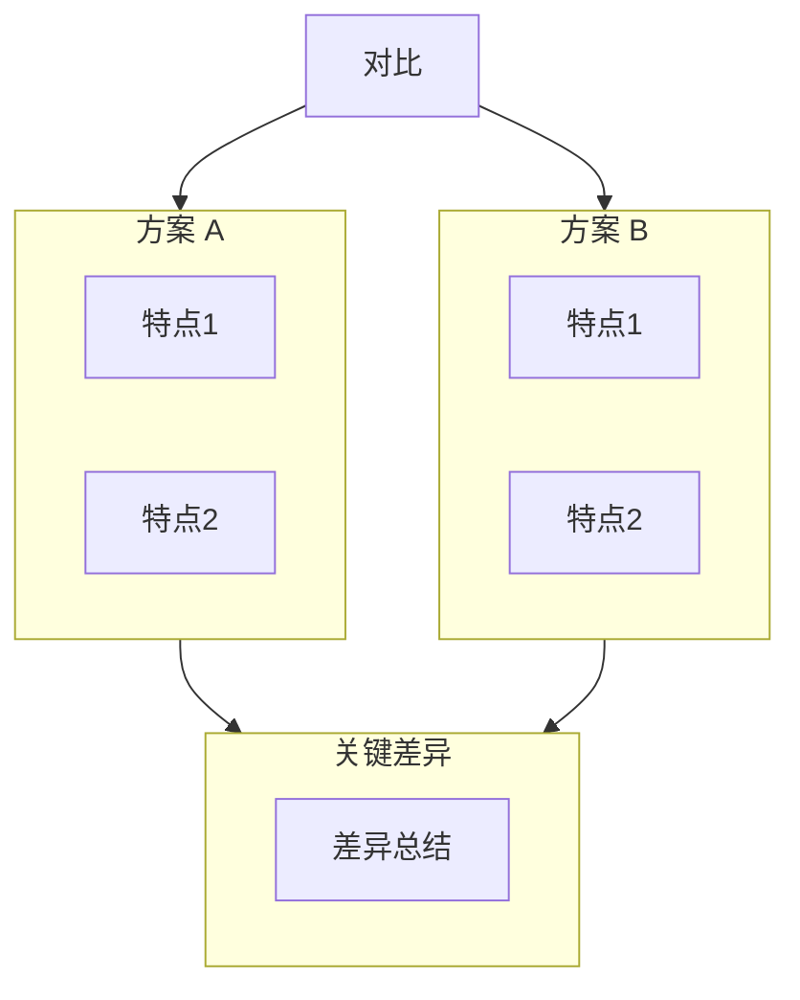

---

## 决策树模板

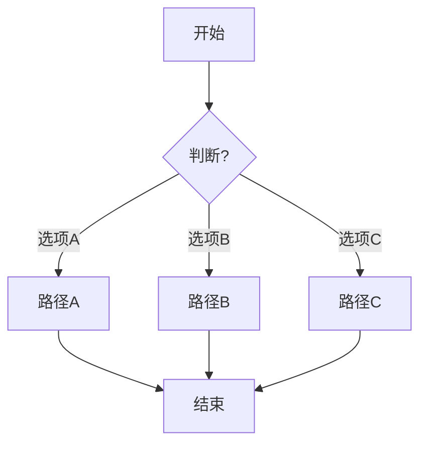

---

## ER 图模板

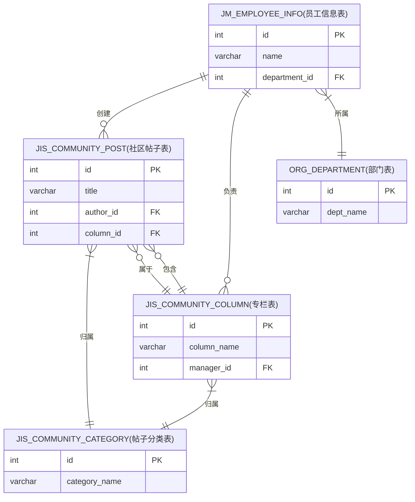

> **ER 图规则：**
> - 表名统一加中文备注后缀：`表名(中文备注)`
> - 关系标签可根据业务场景使用：创建、属于、负责、包含、归属等

---

## 甘特图模板

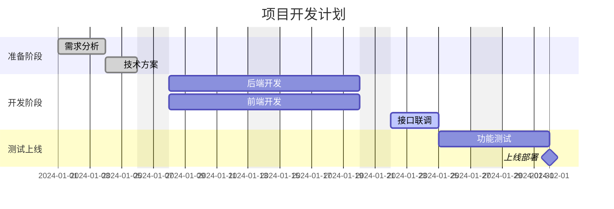

> **甘特图规则：**
> - 日期格式必须统一：`dateFormat YYYY-MM-DD`
> - 任务使用简短ID：`req1`, `backend`
> - 状态标签：`done`（已完成）、`active`（进行中）、`crit`（关键路径）、`milestone`（里程碑）
> - 依赖关系使用 `after taskId`

---

## 饼图模板

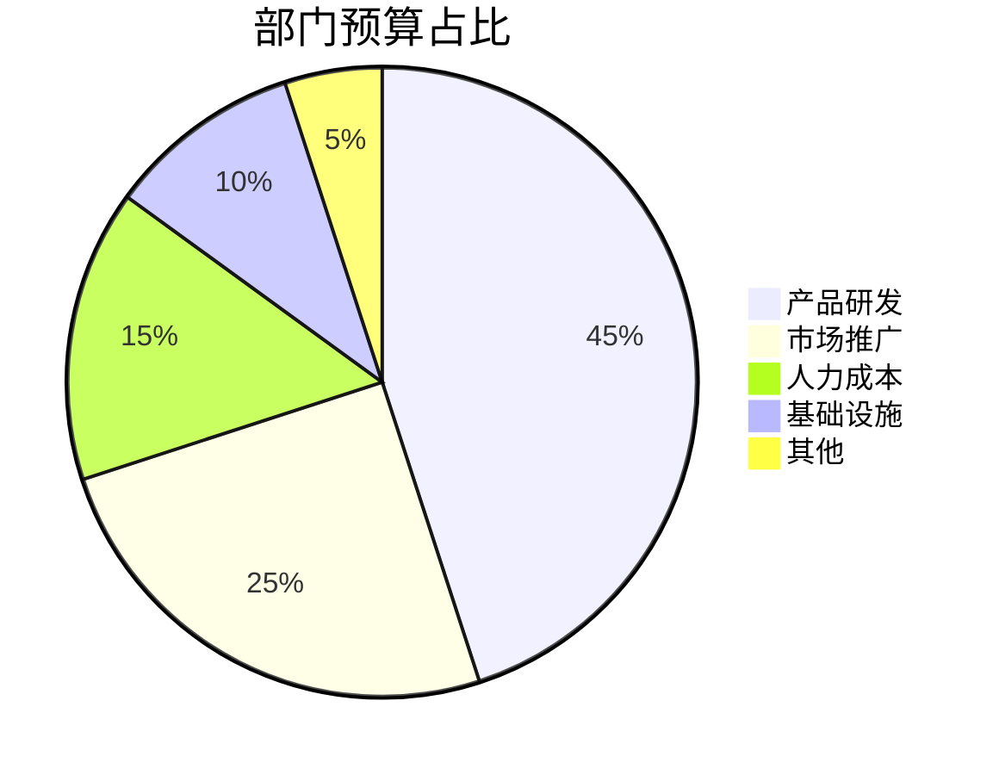

> **饼图规则：**
> - 数据项控制在 3-8 个，超过时合并为"其他"
> - 标签简洁，8字以内
> - 数值会自动计算百分比，无需手动换算
> - 按从大到小排序更清晰

---

## 类图模板

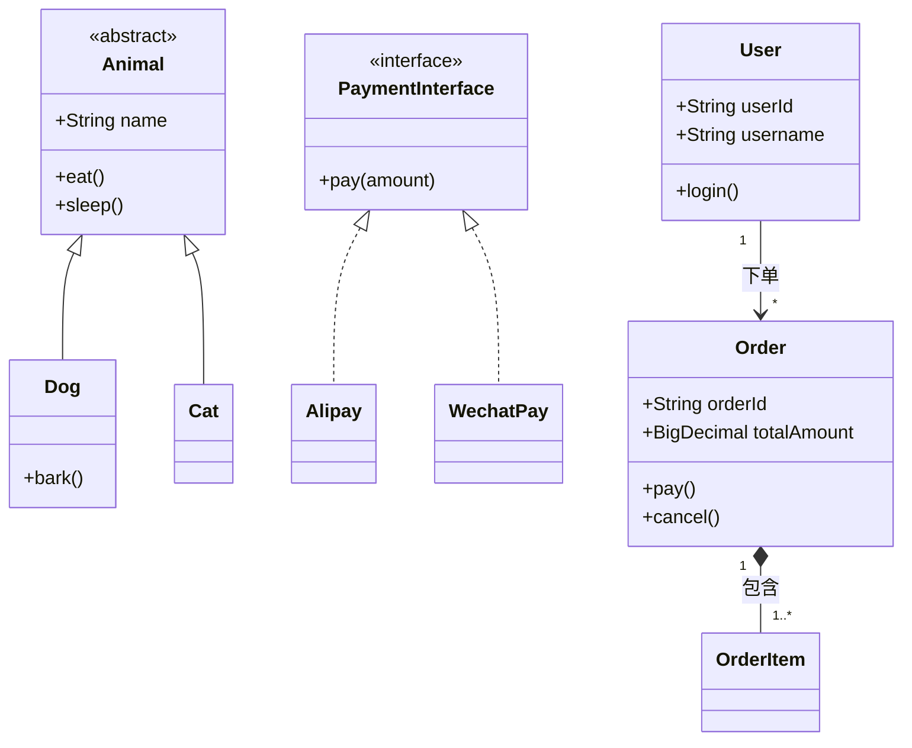

> **类图规则：**
> - 可见性：`+` public, `-` private, `#` protected, `~` package
> - 关系符号：`<|--` 继承, `<|..` 实现, `-->` 关联, `*--` 组合, `o--` 聚合, `..>` 依赖
> - 多重性：在关系两端标注 `"1"`, `"*"`, `"0..1"`, `"1..*"`
> - 构造型：`<<interface>>`, `<<abstract>>`, `<<service>>`, `<<entity>>`