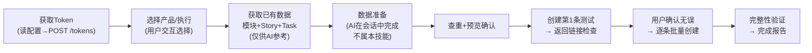
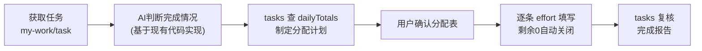

# jpm-zentao-operate

禅道系统操作**引导技能**。只负责一件事：**引导 AI 通过 `zentao` CLI 操作禅道数据**（查询、创建、验证）。

**职责边界**：
- ✅ 属于本技能：CLI 调用引导、API 认证、产品/执行/模块/计划/用户查询、Story/Task 创建与删除、查重比对、创建前后验证、任务工时填写（含补填）与任务关闭、API 异常处理
- ❌ 不属于本技能：来源数据（txt/xlsx 文档等）的读取、解析、字段提取——由 AI 用自身能力在会话中完成，产出结构化数据后再按本技能的 API 规则执行

---

## 前置检查（首次使用/环境异常时）

- 运行 `zentao --version` 验证 CLI 可用；不可用说明未安装 → 进入 CLI 源码目录（见"相关资源"）执行 `npm install -g .`，装好后重试
- 配置缺失或不完整时按"配置文件"节引导 setup

## 核心工具：zentao CLI

`zentao` 命令（npm 全局安装，独立于本技能）— 封装禅道 API 调用（Token 管理、UTF-8 编码、激活→指派流程、链接生成、工时硬规则校验）。任何禅道账号 + 任何产品/执行均可使用，**不含文档解析功能**。

### 命令一览

| 命令 | 说明 |
|------|------|
| `zentao setup --base-url <API地址> --account <账号> --password <密码> [--assignee <默认指派人>]` | 配置禅道账号（首次使用） |
| `zentao login` | 登录，获取所有产品(ID+名称) + 执行(ID+名称) |
| `zentao fetch-data <产品ID> <执行ID>` | 一次获取该产品模块列表 + 全部Story + 该执行全部Task（供AI参考，不展示给用户） |
| `zentao preview <json路径>` | 预览创建内容，输出中文字段完整清单 |
| `zentao create <json路径> [test]` | 创建 Story+Tasks（加 test 参数或 `--test` 只建第1条做测试） |
| `zentao my-work [状态]` | "我的任务"清单（禅道页面数据源，无需执行ID；可选 wait/doing 过滤） |
| `zentao my-tasks <执行ID>` | 列出当前账号在该执行下的任务（状态/预计/消耗/剩余） |
| `zentao task <任务ID>` | 任务详情（状态、工时、efforts 工时明细） |
| `zentao tasks <ID1,ID2,...>` | 批量任务详情 + `dailyTotals`（当前账号按日期已填工时汇总，8h校验用） |
| `zentao effort --task-id <ID> --date <YYYY-MM-DD> --consumed <h> [--left <剩余>] [--work "<内容>"] [--deadline <日期>] [--no-auto-close]` | 填写工时；剩余为0自动完成任务并关闭 |
| `zentao effort <json路径>` | 同上，JSON 文件方式（work 含特殊字符时更稳妥） |
| `zentao close <任务ID>` | 关闭任务（仅 done/cancel 状态） |
| `zentao --version` / `zentao --help` | 版本 / 完整帮助 |

> CLI 未覆盖的操作（如删除、用户列表），按 rules/API操作.md 由 AI 直接发 HTTP 请求。

### 传参约定（PowerShell）

- **优先 flags 传参**：`zentao effort --task-id 1001 --date 2026-10-09 --consumed 2 --work "开发XX功能"`，无转义问题，无需临时文件
- **JSON 文件方式保留**：`work` 内容含全角括号/引号等特殊字符时，或 create/preview 大数据体，写临时 JSON 文件传参（`zentao effort <临时json路径>`，用完即删）
- **禁止把 JSON 直接内联在 PowerShell 命令行**（引号转义易错，实测会报错）

---

## 配置文件

`%USERPROFILE%\.zentao\config.json`（用户主目录，与技能解耦；由 `zentao setup` 写入，也可用 Edit 工具直接编辑）：

```json
{
  "auth": { "baseUrl": "https://zentao.jomoo.com/zentaopms/www/api.php/v1", "account": "", "password": "" },
  "defaultAssignee": ""
}
```

首次使用：用 Read 工具检查该文件，`account`/`password` 为空或文件不存在时，用 AskUserQuestion 询问用户的禅道账号和密码，然后运行 `zentao setup --base-url ... --account ... --password ...` 写入（flags 方式无转义问题）。切换使用者时重新 setup 即可。

> 公司禅道地址固定；账号密码由各用户交互提供。

---

## 核心流程



---

## 工时填写与任务关闭

> 详细规则与流程见 `rules/工时与关闭.md`，异常见 `rules/异常处理.md`。

**硬性规则**：
- 每天所有任务工时总和 ≤ 8h（按**填写日期**统计，补填历史日期同样受限，跨执行也要算）
- 单任务总消耗 ≤ 预计工时（CLI 预检拦截，超出必须重新分配）
- 剩余工时为 0 → 自动完成任务并关闭（`effort` 命令内置 finish + close）
- **补填历史日期前必须先用 `tasks` 查 `dailyTotals`** 得到当天已填工时；当天额度不足就换其他任务/日期灵活分配（总量守恒即可）
- **补填日期按代码提交时间轴分配**：用 `git log` 查对应模块提交日期就近取，不默认填当天
- **截止时间防超期**：工时日期超过任务 `deadline` 时 CLI 自动先调整截止时间再填写/关闭；也可在 effort 参数传 `deadline` 指定最终截止日期
- **只能操作指派给自己的任务**：CLI 强制校验任务 `assignedTo` = 当前账号；先用 `my-work` 筛出自己的任务再操作
- **自动完成后的关闭归属**：`effort` 剩余 0 自动 finish 后任务转 `done` 且 assignedTo 转派给需求创建人，由创建人最终关闭；操作账号显式 `close` 会被 assignedTo 校验拦截，属正常流转非异常，报告表述「已完成待创建人关闭」即可

**流程**：获取任务（`my-work`/`task`）→ AI 根据现有代码实现判断任务是否完成（不确定时 AskUserQuestion 让用户确认）→ 制定工时分配计划（`tasks` 查 dailyTotals，补填日期按 git log 提交时间轴）→ 输出分配表用户确认 → 逐条 `zentao effort` 填写（flags 优先，特殊字符走临时 JSON 文件）→ `tasks` 复核输出报告。



---

## 分阶段调度表

| 阶段 | 内容 | 参考 |
|------|------|------|
| **环境检查** | `zentao --version` 验证 CLI；配置缺失则引导 setup | 本文件 |
| **登录选择** | `zentao login` → 产品(ID+名称)/执行(ID+名称) → 用户选择 | rules/API操作.md |
| **获取已有数据** | `zentao fetch-data <产品ID> <执行ID>`：模块列表 + 全部Story + 全部Task（供AI参考，不展示给用户） | rules/API操作.md |
| **数据准备** | **AI 在会话中完成来源数据解析/字段提取/查重/命名格式判断，缺字段时 AskUserQuestion 询问** | rules/数据映射.md |
| **预览确认** | `zentao preview`：输出中文字段完整清单 + 字段补全记录表 → 用户确认 | rules/验证检查.md |
| **测试创建** | `zentao create ... test`：创建第1条 → 检查状态字段 → 返回链接给用户检查 | rules/验证检查.md |
| **批量创建** | `zentao create ...`：逐条创建剩余全部 → 语义比对完整性验证 → 完成报告 | rules/验证检查.md |
| **工时与关闭** | 判断任务完成（基于现有代码实现）→ `tasks` 查当日已填 → 分配计划确认 → `effort` 逐条填写（剩余0自动关闭）→ `tasks` 复核报告 | rules/工时与关闭.md |
| **异常处理** | 出错时加载 | rules/异常处理.md |

---

## 创建行为关键说明

- **Story 直接激活**：POST创建 → review激活 → assign指派（不是草稿状态）
- **Story 同时关联执行和计划**：`execution` 和 `plan` 两个字段都传
- **任务关联 Story**：自动关联刚创建的研发需求ID
- **命名格式动态判断**：优先分析禅道已有 Story/Task 命名规律推断格式，第一条数据展示时必须询问用户确认，不硬编码
- **空数据场景**：禅道无已有数据时，根据用户提供的待创建数据推断格式（标注"禅道无已有数据，格式为推断"并请用户确认）；指派人优先询问用户或用登入账号兜底；查重报告输出"禅道无已有数据，全部新建"
- **模块使用产品级 ID**：Story 和 Task 共用产品级模块ID，`module` 不能传 `0`，无模块传 `-1`
- **查重用语义归一化**：去掉系统前缀/分隔符/"的"后比对，避免漏判重复
- **测试→批量流程**：先输出第1条测试数据字段供用户确认 → 创建1条测试让用户检查链接 → 确认无误后再批量创建
- **字段补全记录**：凡因数据缺失询问用户的，都记录到"字段补全记录表"，预览确认时一并展示核查

---

## 相关资源

- 禅道 API 文档：https://zentao.jomoo.com/zentaopms/www/api-docs.html
- CLI 源码：`C:\Users\JOMOO\.agents\cli\zentao-cli`（全局命令经 Junction 指向此处；API 端点速查与未覆盖操作见 rules/API操作.md）
- 配置文件：`%USERPROFILE%\.zentao\config.json`
- 所有子规则文件位于本技能目录 `rules/` 下
