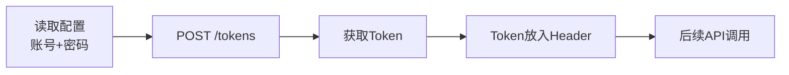

# 规则-API操作

> **用途**：禅道API认证、CRUD操作、数据查询、创建流程
> **加载时机**：需要调用禅道API时（主流程步骤4/5）

> **调用方式**：AI 直接发 HTTP 请求（curl / node fetch 等）。凭据从 `%USERPROFILE%\.zentao\config.json` 读取（baseUrl/account/password）。注意：PowerShell 中用 curl 传 JSON body 时引号转义易出错，建议把 body 写入临时 JSON 文件后用 `curl -d "@body.json"`，或改用 node 的 fetch。常规查询/创建/工时操作优先用 `zentao` CLI（见 SKILL.md 命令一览）。

---

## API认证流程



```bash
# 获取Token
curl -s -X POST "{baseUrl}/tokens" \
  -H "Content-Type: application/json" \
  -d '{"account":"{账号}","password":"{密码}"}'
```

---

## 研发需求操作（Story）

### 创建需求（直接激活）

创建需求需要**连续执行3个API**，结果直接为"已激活"。

```
正确流程: POST /stories → POST /stories/{id}/review → POST /stories/{id}/assign
结果: 需求状态 = active（非草稿）
```

### 创建需求字段

**端点**：`POST /api.php/v1/stories`

**字段说明**：

| 字段 | 说明 | 示例 |
|------|------|------|
| `product` | **产品ID**（API动态获取，登录后交互选择） | `240` |
| `title` | **需求标题**（命名格式由AI分析已有Story后判断，第一条展示时询问用户确认） | `"JPM：测试流程-测试功能点"` |
| `spec` | **需求描述**（由AI根据文档内容组合，格式不固定） | `"JPM\n测试改功能点有无问题"` |
| `category` | 类别 | `"common"` |
| `type` | 类型 | `"story"` |
| `source` | 来源 | `"other"` |
| `module` | **产品级模块ID**（API动态获取，登录后交互选择） | `2649` |
| `assignedTo` | **指派人账号** | `"<账号>"` |
| `execution` | **关联执行ID**（API动态获取，登录后交互选择） | `1231` |
| `plan` | **关联计划ID**（API动态获取，登录后交互选择） | `459` |
| `pri` | 优先级(1高/2中/3低) | `3` |

> ⚠️ **同时关联执行和计划**：创建Story时同时传 `execution` 和 `plan` 字段。`plan` 通过 `GET /products/{id}/plans` 获取，`execution` 通过 `GET /executions` 获取。已有Story可能只用plan关联，新创建时两个都传确保兼容。

### 激活需求

**端点**：`POST /api.php/v1/stories/{id}/review`

```bash
curl -X POST "{baseUrl}/stories/{id}/review" \
  -H "Content-Type: application/json" -H "Token: $TOKEN" \
  -d '{"result":"pass"}'
```

### 重新指派（必须在激活后执行）

**端点**：`POST /api.php/v1/stories/{id}/assign`

```bash
curl -X POST "{baseUrl}/stories/{id}/assign" \
  -H "Content-Type: application/json" -H "Token: $TOKEN" \
  -d '{"assignedTo":"{指派账号}"}'
```

> 激活(review)会清空指派，必须在激活后重新指派。

### 删除需求

**端点**：`DELETE /api.php/v1/stories/{id}`
- ⚠️ 删除前必须验证创建人
- 通过 `GET /actions?story={id}` 检查 `actions.opened.actor`
- 只能删除当前用户创建的需求

---

## 任务操作（Task）

### 创建任务

**端点**：`POST /api.php/v1/executions/{executionId}/tasks`

**字段说明**：

| 字段 | 说明 | 示例 |
|------|------|------|
| `name` | **任务名称**（命名格式由AI分析已有Task后判断，与Story标题保持一致风格，第一条展示时询问用户确认） | `"JPM：测试流程-测试功能点：测试改功能点有无问题"` |
| `assignedTo` | **指派账号** | `"<账号>"` |
| `type` | **任务类型** | `"devel"`（开发） |
| `module` | **所属模块**（产品级ID） | `2649` |
| `story` | **相关研发需求ID**（创建后自动关联） | `13998` |
| `estStarted` | 预计开始 | `"2026-08-03"` |
| `deadline` | 截止日期 | `"2026-08-09"` |
| `pri` | 优先级(1-4) | `3` |
| `desc` | 任务描述 | `"功能描述内容"` |
| `estimate` | 预估工时 | `4` |

> ⚠️ **模块ID、需求ID、任务类型**不能缺漏，三个字段必须同时设置。

### 删除任务

**端点**：`DELETE /api.php/v1/tasks/{id}`
- ⚠️ 删除前必须验证创建人

### 获取任务详情

**端点**：`GET /api.php/v1/tasks/{id}`

关键字段：

| 字段 | 说明 |
|------|------|
| `status` | wait(未开始)/doing(进行中)/done(已完成)/pause(已暂停)/cancel(已取消)/closed(已关闭) |
| `estimate` | 预计工时 |
| `consumed` | 总消耗工时 |
| `left` | 剩余工时 |
| `deadline` | 截止日期（未设置为 `0000-00-00`） |

> ⚠️ **开源版 `GET /tasks/{id}` 不含 efforts 工时明细**（已实测确认），需另调 `GET /tasks/{id}/estimate`（zentao CLI 的 `task`/`tasks` 命令已封装）。

### 获取工时明细

**端点**：`GET /api.php/v1/tasks/{id}/estimate`

```json
{ "effort": [ { "id": 50324, "objectType": "task", "objectID": 24984, "account": "W00120", "date": "2026-09-16", "consumed": 2, "left": 6, "work": "功能开发" } ] }
```

> 用于"每天≤8h"校验的按日期汇总（`tasks` 命令的 `dailyTotals` 已内置此数据源）。

### 记录工时（填写工时）

**官方端点**：`POST /api.php/v1/tasks/{id}/estimate`（开源版 18.x 路由表确认，**已实测可用**；zentao CLI effort 命令已内置，异常时自动回退单值/旧路径）

**字段为批量行式数组**（源码 `task->recordEstimate()` 按 `foreach(array_keys($record->dates))` 处理，单值会报 `array_keys(): Argument #1 must be of type array`）：

| 字段 | 说明 | 示例 |
|------|------|------|
| `dates` | 工时日期数组（YYYY-MM-DD，不能大于今天） | `["2026-10-12"]` |
| `consumed` | 本次消耗工时数组（数字且 >0） | `[4]` |
| `left` | 填写后的剩余工时数组（不是本次消耗） | `[4]` |
| `work` | 工作内容数组 | `["开发XX功能"]` |

> ⚠️ 规则：总消耗(consumed)不能超过预计工时(estimate)；剩余(left)为 0 时任务应完成并关闭（effort 命令已内置自动 finish + close）。
> POST 成功后直接返回更新后的任务对象（含 consumed/left/status）。

### 完成任务

**端点**：`POST /api.php/v1/tasks/{id}/finish`

```bash
curl -X POST "{baseUrl}/tasks/{id}/finish" \
  -H "Content-Type: application/json" -H "Token: $TOKEN" \
  -d '{"realStarted":"2026-10-12","consumed":8,"left":0}'
```

> consumed 为任务总消耗；一般由 effort 命令在剩余为 0 时自动调用，无需手动执行。

### 修改截止时间（防超期）

**端点**：`PUT /api.php/v1/tasks/{id}`

```bash
curl -X PUT "{baseUrl}/tasks/{id}" \
  -H "Content-Type: application/json" -H "Token: $TOKEN" \
  -d '{"deadline":"2026-10-12"}'
```

- 工时日期超过任务 `deadline` 时必须先调整，避免任务超期完成
- `deadline` 为空或 `0000-00-00` 视为未设置，不调整
- `effort`/`close` 命令已内置自动调整（effort 可用 `deadline` 字段指定最终截止日期）

### 关闭任务

**端点**：`POST /api.php/v1/tasks/{id}/close`

body 传 `{}` 即可；仅 `done`/`cancel` 状态可关闭。

---

## 数据查询API

| 端点 | 方法 | 说明 |
|------|------|------|
| `/api.php/v1/products` | GET | 获取所有产品列表 |
| `/api.php/v1/executions` | GET | 获取所有执行列表（分页，需去重） |
| `/api.php/v1/products/{id}/plans` | GET | 获取产品的计划列表 |
| `/api.php/v1/modules?type=story&id={productId}` | GET | 获取产品级模块列表 |
| `/api.php/v1/users` | GET | 获取所有用户（中文名→账号映射） |
| `/api.php/v1/products/{id}/stories` | GET | 获取产品下所有需求 |
| `/api.php/v1/executions/{id}/tasks` | GET | 获取执行下所有任务 |
| `/api.php/v1/tasks?assignedTo={账号}` | GET | 获取该账号的全部任务（含 done/closed；zentao CLI `my-work` 已封装未完成部分） |
| `/api.php/v1/tasks/{id}/estimate` | GET | 任务工时明细（effort 记录列表） |
| `{webUrl}my-work-task.json` | GET | "我的任务"页面数据源（**Token 头可直接访问**，仅未完成任务 wait/doing） |

---

## 调用约定

- **凭据**：从 `%USERPROFILE%\.zentao\config.json` 读取 baseUrl/account/password，不在会话中明文追问
- **Token 管理**：401 时重新 POST /tokens 获取
- **编码**：请求 body 使用 UTF-8；PowerShell 终端显示中文可能乱码，AI 解析 JSON 响应时以数据为准
- **逐条创建**：批量场景下循环调用单条创建接口（Story 三连 + Task），不要用 batchCreate（无效，见 rules/异常处理.md）

---

## Web URL（用于生成检查链接）

从API URL推导：`{baseUrl}` 去掉 `/api.php/v1` 部分。

示例：
- **API**: `https://zentao.jomoo.com/zentaopms/www/api.php/v1`
- **Web**: `https://zentao.jomoo.com/zentaopms/www/`
- **Story链接**: `{webUrl}story-view-{id}.html`
- **Task链接**: `{webUrl}task-view-{id}.html`
