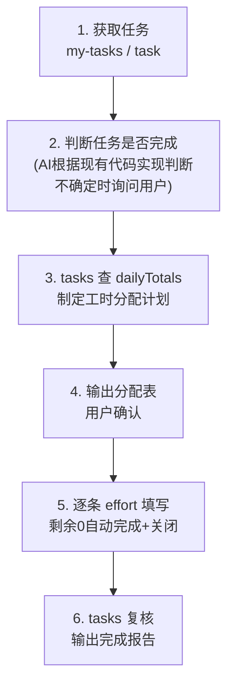

# 规则-工时填写与任务关闭

> **用途**：任务完成情况判断、工时填写（含补填历史日期）、任务关闭
> **加载时机**：用户要求填工时、补工时、关闭任务、根据现有代码判断任务是否完成时

---

## 硬性规则（每一条都必须满足）

| # | 规则 | 说明 |
|---|------|------|
| 1 | **每天所有任务工时总和 ≤ 8h** | 按**填写日期**统计（不是按今天），补填历史日期同样受限；跨执行的任务也要算进去 |
| 2 | **单任务总消耗 ≤ 预计工时** | `consumed` 总和不能超过 `estimate`；CLI 会预检拦截，超出时必须重新分配 |
| 3 | **剩余工时为 0 → 自动完成+关闭** | `effort` 命令自动执行 finish + close，无需额外操作 |
| 4 | **补填历史日期前必须查询当天已填工时** | 用 `tasks <ids>` 的 `dailyTotals`（当前账号按日期汇总）；当天剩余额度不足时，**换其他任务或换其他日期**填写，工时可以灵活分配，总量守恒即可 |
| 5 | **不能填未来日期** | CLI 会校验 `date ≤ 今天` |
| 6 | **截止时间防超期** | 工时日期（或关闭当天）超过任务 `deadline` 时，CLI **自动先调整截止时间再填写/关闭**；也可在 effort 参数传 `deadline` 指定最终截止日期（不得早于工时日期） |

---

## 标准流程



### 1. 获取任务（只筛选指派给自己的）

```bash
zentao my-work [wait|doing]     # "我的任务"清单（无需执行ID，首选）
zentao my-tasks <执行ID>        # 当前账号在该执行下的任务清单（已按指派人过滤）
zentao task <任务ID>            # 单任务详情(含工时明细，isMine标记)
zentao tasks <ID1,ID2,...>      # 批量详情 + dailyTotals
```

> ⚠️ **只能操作指派给自己的任务**（CLI 强制校验 `assignedTo = 当前账号`，非自己的任务直接报错）。首选 `my-work` 直接拉取"我的任务"（对应禅道 my-work-task 页面数据源，无需执行ID）；`task`/`tasks` 返回的 `isMine` 字段可用于二次确认。

### 2. 判断任务是否完成（AI 职责）

> 判断依据 = **现有代码实现情况**（用户口述、工作区代码、git 提交记录等，由 AI 在技能外分析）

- AI 逐个分析任务描述与代码实现的对应关系：功能已实现且无遗留问题 → 视为完成
- 无法确定的任务，用 AskUserQuestion 让用户逐个确认（完成 / 未完成 / 部分完成）
- 输出任务完成情况清单（任务ID/名称/状态/预计/已消耗/是否完成），用户确认后再进入工时填写
- 只对"完成"的任务填满工时并关闭；未完成的任务不动

### 3. 工时分配计划（AI 计算）

对每个已完成任务：

- **目标总消耗** = 使 `consumed` 达到某个 ≤ `estimate` 的值（通常直接补满到 `estimate`）
- **本次填写量** = 目标总消耗 - 当前 `consumed`
- 剩余 `left` 由 CLI 自动计算（当前剩余 - 本次消耗）；总消耗 = estimate 时剩余为 0 → 自动关闭

对补填日期（历史日期）：

- **日期默认按代码提交时间轴分配**：用 `git log` 查对应模块/文件的提交日期就近取（含关联提交的日期），**不默认填当天**；提交时间轴与工时日期能相互印证，避免审计对不上
- **当天剩余额度** = 8 - `dailyTotals[该日期]`
- 额度不足时：把工时**挪到其他日期（必须 ≤ 今天）或其他任务**，保持总量守恒
- 分摊尽量自然：优先平均分布到工作日，避免单日爆量或全塞同一天

**分配示例**（任务A预计12h已填4h，任务B预计4h未填，10-09已填6h）：

```
任务A还需 8h、任务B还需 4h，共 12h 待填。
dailyTotals: 10-09 已填 6h(剩2h)、10-10 已填 0h(剩8h)、10-11 已填 8h(剩0h)。
分配方案:
  10-09: 任务A +2h (当天合计 8h，额度用满)
  10-10: 任务A +4h、任务B +4h (当天合计 8h)
  10-11: 不填 (已满 8h，换其他日期)
任务A剩余 12-12=0 → 自动关闭；任务B剩余 0 → 自动关闭
```

### 4. 输出分配表（用户确认）

```
===== 工时分配计划 =====
| 任务 | 日期 | 本次工时 | 当天合计 | 任务剩余 |
|------|------|---------|---------|---------|
| #1001 XX功能(需8h) | 2026-10-09 | 2h | 8h | 6h |
| #1001 XX功能 | 2026-10-10 | 4h | 8h | 2h |
| #1002 YY功能(需4h) | 2026-10-10 | 4h | 8h | 0(自动关闭) |

待确认：日期/工时分配是否可以？
```

### 5. 逐条填写

**优先 flags 传参**（PowerShell 无转义问题，无需临时文件）：

```bash
zentao effort --task-id 1001 --date 2026-10-09 --consumed 2 --work "开发XX功能"
```

- `--left` 建议省略（CLI 自动按 当前剩余-本次消耗 计算）
- `--deadline` 可选：指定任务最终截止日期（不得早于工时日期）；省略时若工时日期超过任务截止时间，CLI 自动把截止时间调整为工时日期（避免超期完成）
- `--no-auto-close` 可关闭"剩余为 0 自动 finish + close"行为

**JSON 文件方式兜底**：`work` 内容含全角括号/引号等特殊字符、或 flags 传参报错时，写临时 JSON 文件传参：

```bash
zentao effort "<临时json文件路径>"
```

> ⚠️ **禁止把 JSON 直接内联在 PowerShell 命令行**：`work` 描述含中文+括号（如"（含签呈）"）时，即使 `\"` 转义，PowerShell 仍会把括号内容解析为命令执行报错（实测 `（含签呈）: The term ... is not recognized`）。flags 传参可规避此问题；仍走 JSON 方式时写临时文件，填写完成后立即删除临时文件。

```json
{ "taskId": 1001, "date": "2026-10-09", "consumed": 2, "work": "开发XX功能" }
```

- `work` 写实际工作内容（如"开发XX功能"）
- CLI 已内置：官方 estimate 端点 + 回退链、批量行式数组字段、截止时间自动调整、回读验证、超预计拦截、未来日期拦截

### 6. 复核报告

填写完成后用 `tasks <ids>` 复核并输出：

- 每日合计 ≤ 8h（列出每天合计）
- 每任务 `consumed ≤ estimate`
- 应关闭的任务 status 都是 `closed`
- 附所有任务链接，请用户确认

---

## 注意事项

- **只操作自己的任务**：CLI 强制校验任务 `assignedTo = 配置文件的登录账号`，`effort`/`close` 操作他人任务会直接报错；工时记录归属 = 登录账号
- **跨执行补填**：把相关执行下自己的任务都纳入 `tasks <ids>` 查询，`dailyTotals` 才完整；漏查会导致当天超 8h（`my-work` 只含未完成任务，已完成任务的当天工时也要计入）
- **efforts 明细来源**：开源版 `GET /tasks/{id}` 不含工时明细，CLI 自动改调官方端点 `GET /tasks/{id}/estimate` 获取（已实测可用）。若 estimate 端点也拿不到明细但 `consumed > 0`，当天已填工时**不可按 0 计算** → AskUserQuestion 询问用户后再规划
- **状态与操作对应**：
  - `wait`/`doing`/`pause` → 可填工时；剩余 0 自动 finish + close
  - `done` → 无需填工时，可直接 `close` 关闭
  - `cancel` → 无需填工时，可直接 `close` 关闭
  - `closed` → 无需任何操作
- **自动完成后的关闭归属（实测行为）**：`effort` 剩余 0 自动 finish 后，任务状态变 `done` 且 `assignedTo` 自动转派给**需求创建人**（非操作账号）；此时操作账号再显式 `close` 会被 assignedTo 校验拦截报错「任务指派给XXX，不是当前账号的任务」。这是禅道标准流转（done → 创建人确认关闭），**非异常**：报告表述为「已完成，待创建人最终关闭」即可，禁止尝试绕过校验强制关闭
- **截止时间说明**：任务的 `deadline` 为空或 `0000-00-00` 视为未设置，不调整；`close` 命令也会在截止时间早于今天时自动先调整再关闭
- 填写失败回读验证不通过时，先打开任务链接人工检查，再决定重试或换日期/任务
