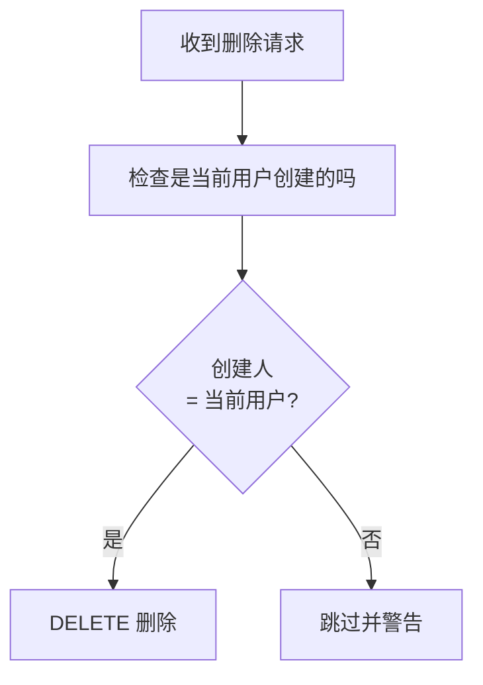
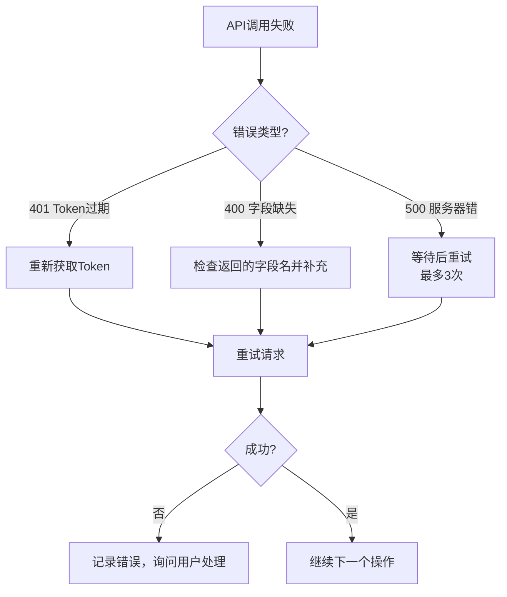

# 规则-异常处理

> **用途**：API错误处理、边界情况、安全规则、恢复策略
> **加载时机**：出现错误、异常或需要处理边界情况时

---

## 错误码速查

| HTTP状态 | 错误信息 | 原因 | 解决方案 |
|----------|---------|------|---------|
| 401 | Unauthorized | Token无效或过期 | 重新获取Token |
| 404 | Not Found | 任务/需求不存在 | 检查ID是否正确 |
| 403 | Forbidden | 无权限 | 检查账号权限 |
| 400 | `所属模块不能为空` | module传了0 | 传正确ID |
| 400 | `预计开始不能为空` | 缺少estStarted | 补充字段 |
| 400 | `类别不能为空` | 缺少category | 传"common" |
| 400 | `登录失败` | Token过期或密码错 | 重新认证 |
| 500 | `Too few arguments` | API端点错误 | 检查URL路径 |
| 200 | 数据不变 | 用PUT修改deleted字段 | 用DELETE方法 |
| 200 | 不创建 | 用了batchCreate | 用单条创建 |
| 403 | `no company-browse priv` | 账号无用户列表查看权限 | 改用从已有Story/Task的assignedTo对象反向提取 realname→account 映射 |
| 400 | `『预计开始』不能为空` | Task创建时estStarted为空 | 必须传estStarted和realStarted字段（文档中开始时间为空时填默认日期如2026-07-01） |
| 500 | `array_keys(): Argument #1 must be of type array` | 记录工时字段传了单值 | effort 命令已内置批量行式数组字段（dates[]/consumed[]/left[]/work[]）；手动调接口时必须传数组 |
| 400 | `总消耗不能超过总预计` | consumed 总和超过 estimate | 减小本次工时或分摊到其他日期/任务（见 rules/工时与关闭.md） |
| 400 | finish/close 状态错误 | 任务当前状态不允许该操作 | wait/doing 需先 finish 才能转 done；close 仅 done/cancel 可关 |
| 403 | close 无权限 | 当前账号无关闭权限 | 告知用户通过禅道网页手动关闭 |
| 400 | PUT 调整截止时间失败 | 无编辑权限或截止日期受执行结束日期限制 | 换执行允许的日期或告知用户网页手动调整 |
| — | `任务指派给 X，不是当前账号的任务` | 操作了非指派给自己的任务（CLI 强拦截） | 用 `my-work` / `my-tasks <执行ID>` 筛选自己的任务；若指派人错误，告知用户网页修改指派 |
| — | estimate 端点拿不到明细但 consumed>0 | 工时明细端点异常 | 用 AskUserQuestion 询问用户该日期已填工时后再规划，**不可按 0 计算** |

### API分页重要说明

> ⚠️ **禅道API的 `page` 参数不生效**：分页查询时每页都返回第1页数据，循环翻页会导致数据重复累加。

**正确做法**：用 `limit=500` 一次获取全部数据，不要用 `page` 参数翻页。

```bash
# 错误：page参数不生效，每页都返回第1页
GET /products/{id}/stories?page=1&limit=100  # 第1页
GET /products/{id}/stories?page=2&limit=100  # 还是第1页！

# 正确：用大limit一次获取
GET /products/{id}/stories?limit=500
```

---

## 已知API限制

### 1. 激活清空指派（已知Bug）

创建需求时设置的 `assignedTo` 会在激活(`/review`)后被清空。

**解决方案**：激活后必须调用 `/assign` 重新指派。创建时按 rules/API操作.md 的 POST → review → assign 流程执行。

### 2. PUT无法修改只读字段

以下字段通过PUT修改时返回HTTP 200但字段不变：
- `assignedTo`（指派人）
- `finishedBy`（完成人）
- `deleted`（删除标记）
- `status`（状态）

**解决方案**：
- 指派用 `POST /assign`（非PUT）
- 删除用 `DELETE /{id}`（非PUT deleted=1）

### 3. batchCreate 无效

`POST /executions/{id}/tasks/batchCreate` 返回200但不创建任何任务。
**解决方案**：逐条调用单条创建接口。

### 4. 非必填字段可省略

- category/type/source 等字段：API要求必填时传，不要求时可不传
- 如果API返回"XXX不能为空"，则补传该字段

---

## 安全规则

### 1. ZenTao ID是全局的

任务ID、需求ID**全局递增**，跨越所有产品/项目。

### 2. 删除前必须验证创建人



### 3. 禁止修改原有数据

- 不允许通过PUT修改已有的任务/需求的任何字段
- 只通过POST创建新数据
- 创建错误时先DELETE再重新POST

### 4. 模块ID规则

- `module` 不能传 `0`，无模块时传 `-1`
- 有模块时传正确的**产品级模块ID**
- 任务和需求都使用产品级模块ID

---

## 边界情况处理

### 创建失败重试



---

## 恢复策略

### 误创建的需求/任务

| 场景 | 处理方式 |
|------|---------|
| 测试创建不通过 | DELETE 删除后重新创建 |
| 需求创建错误 | DELETE /stories/{id}（先验证创建人） |
| 任务创建错误 | DELETE /tasks/{id}（先验证创建人） |
| 指派错误 | 告知用户通过禅道网页手动修改 |
| 字段填错 | 告知用户通过禅道网页手动修改 |

### 不可恢复的操作

以下操作一旦执行无法通过API恢复：
- 删除原有数据（已禁止执行）
- 修改原有数据的指派人/完成人（API不支持PUT修改）
