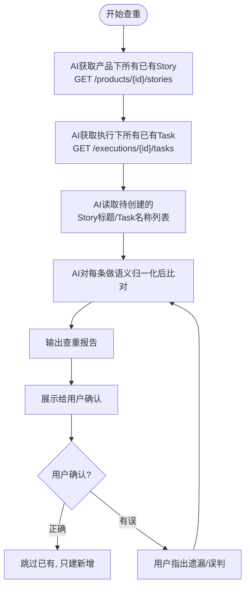

# 规则-数据映射

> **用途**：AI查重匹配策略、命名格式判断、指派人映射、优先级/工时映射规则（来源数据由 AI 在技能外解析，本规则只约定与禅道侧交互的映射要求）
> **加载时机**：创建前AI查重或需要补充字段值时

---

## 字段补全记录（重要）

> **任何一次因数据缺失而询问用户的场景，都必须记录到"字段补全记录表"**，在步骤4.5（测试数据字段确认）时一并展示给用户核查，避免遗漏。

### 何时需要记录

凡是 AI 因来源数据缺字段、查不到映射、无法判断而**询问用户**的场景，都要记录：

| 场景 | 触发条件 | 示例 |
|------|---------|------|
| 来源数据缺字段 | 来源数据某列为空，无法提取 | 来源数据无"模块"列 → 询问用户选哪个模块 |
| 指派人查不到 | 来源数据有中文名但反向提取不到账号 | "李四"在已有数据中找不到 → 询问账号 |
| 模块匹配不到 | 子模块/主模块两级都匹配失败 | 来源数据"项目费用管理" ≠ 禅道"项目费用" → 询问用户 |
| 命名格式不确定 | 空数据场景或格式推断不确定 | 禅道无已有数据 → 询问格式是否正确 |
| 时间字段为空 | 来源数据开始/截止时间为空 | 询问用户用默认日期还是指定日期 |

### 记录格式

AI 在会话内维护一张表，每询问一次就追加一行：

```
=== 字段补全记录表 ===
| # | 影响范围 | 缺失字段 | 来源数据原值 | 用户回答 | 应用方式 |
|---|---------|---------|---------|---------|---------|
| 1 | 行5的Story | 模块 | (空) | 项目规划(ID=2539) | Story和其下Task用此模块ID |
| 2 | 行12的Task | 指派人 | 李四 | W00296(夏子洲) | 行12的Task指派给W00296 |
| 3 | 行15的Task | 开始时间 | (空) | 2026-07-01 | 行15的Task用此日期 |
| 4 | 全部Story | 命名格式 | (无已有数据) | {系统}：{模块}-{功能} | 应用到所有Story标题 |
```

### 展示时机

在**步骤4.5（测试数据字段确认）**时，除了输出第1条 Story+Task 的字段详情外，**必须同时输出"字段补全记录表"**，让用户一次性核查所有人工补全的内容。

### 展示示例

```
===== 第1条测试数据字段确认 =====

【Story】
  标题: ...  模块: ...  指派人: ...
【Task】
  名称: ...  指派人: ...

===== 字段补全记录表（共4项人工补全）=====
| # | 影响范围 | 缺失字段 | 来源数据原值 | 用户回答 | 应用方式 |
| 1 | 行5 Story | 模块 | (空) | 项目规划(2539) | Story+Task用此模块 |
| 2 | 行12 Task | 指派人 | 李四 | W00296(夏子洲) | Task指派给W00296 |
| 3 | 行15 Task | 开始时间 | (空) | 2026-07-01 | Task用此日期 |
| 4 | 全部Story | 命名格式 | (空数据) | {系统}：{模块}-{功能} | 应用所有标题 |

请确认：
  1. 第1条字段是否正确？
  2. 字段补全记录表是否正确？有遗漏或误填吗？
```

> ⚠️ **关键原则**：凡是询问过用户的，都要记录；凡是记录的，都要在步骤4.5展示。避免"问了就忘"导致字段错填或漏填。

---

## 命名格式动态判断（重要）

> **命名格式不硬编码**：不同产品/项目的Story和Task命名格式可能不同。命名格式来源有两种：① 禅道已有数据 ② 用户上传的来源数据。AI 必须优先用已有数据推断；若禅道为空，则完全依赖来源数据分析。

**AI判断流程**：
1. 获取该产品下已有Story，分析标题的命名规律（分隔符、字段顺序、是否有系统前缀等）
2. 获取该执行下已有Task，分析名称的命名规律
3. **判断禅道数据是否为空**：
   - **场景A（有数据）**：根据已有数据推断命名格式，应用到待创建数据
   - **场景B（空数据，见下节）**：完全依赖用户上传的来源数据推断
4. **第一条数据展示时，必须询问用户确认命名格式是否正确**
5. 用户若有特殊要求，按用户指定格式执行

### 场景B：禅道数据为空时的命名格式判断

> ⚠️ **空数据场景很常见**：新产品、新执行、初次接入的禅道都可能没有任何已有Story/Task。此时 AI 不能因"无已有数据"就停止，必须**完全依赖用户上传的来源数据**来推断命名格式。

**空数据下的AI推断规则**（按优先级）：
1. **分析来源数据表头结构**：根据表头列名判断哪些列是「系统/模块/功能/细节点」等
2. **分析来源数据数据内容**：观察每列数据的实际写法（是否有系统前缀、用什么分隔符、字段顺序如何）
3. **推断合理命名格式**：
   - 若来源数据有「系统」列且非空 → 推断格式 `{系统}：{模块}-{功能}` 或 `{系统}-{模块}-{功能}`
   - 若来源数据无「系统」列 → 推断格式 `{模块}-{功能}` 或 `{模块}：{功能}`
   - 若来源数据只有「功能描述」一列 → 直接用功能描述作为标题
   - 分隔符优先用全角「：」和半角「-」（最常见）
4. **第一条数据展示时，必须明确标注"格式为AI根据来源数据推断（禅道无已有数据）"，并询问用户确认**
5. **如果用户对命名格式有特殊要求**（如自定义前缀、特定分隔符、加入版本号等），按用户指定执行

**空数据场景的查重处理**：
- 禅道无已有Story/Task时，查重报告应输出「禅道无已有数据，全部为新建」
- 仍需保留语义归一化查重逻辑（防止用户重复上传同一来源数据时重复创建）

**空数据场景的指派人处理**：
- 无法从已有Story/Task反向提取账号映射（因为没数据）
- 优先用 AskUserQuestion 询问用户指派人账号
- 兜底使用配置文件 `%USERPROFILE%\.zentao\config.json` 的 `defaultAssignee`（即登入账号）

**空数据场景的模块匹配处理**：
- 仍通过 `GET /modules?type=story&id={productId}` 获取产品模块列表（模块列表通常不为空）
- 若模块列表也为空 → 用 AskUserQuestion 询问用户模块名，或传 `-1` 不指定模块

**示例（仅为说明，非固定格式）**：
- 产品A已有Story格式：`系统：模块-功能`（如 `JMBOS：项目信息-快速通道`）
- 产品B已有Story格式：`模块-功能`（如 `项目立项-新增`）
- 产品C（空数据）来源数据结构：系统|模块|功能 → AI推断格式 `{系统}：{模块}-{功能}`，第一条询问用户确认
- 产品D（空数据）来源数据结构：功能描述 → AI推断格式 `{功能描述}`，第一条询问用户确认

> AI应适配各产品已有格式或来源数据结构，而非统一用一种。**关键原则**：有数据用数据，没数据用来源数据，没来源数据用常识，最后一定要询问用户确认。

---

## 查重匹配策略

> 创建前必须先查重。AI获取禅道已有数据，用语义理解判断是否重复，跳过已存在的项，只创建新增的。

### 查重流程



### 语义归一化查重（重要）

> 已有Story/Task的命名格式可能不统一，必须用**语义归一化**后比对，而非字符串精确匹配。

**归一化规则**（按顺序处理）：
1. 去掉系统前缀：`JMBOS：` / `JPM：` / `PMS：` 等开头的前缀
2. 去掉分隔符：`：` `:` `-` `－` 空格
3. 去掉连接词：`的`
4. 转小写

**示例**：
| 已有标题 | 待创建标题 | 归一化后 | 判定 |
|---------|-----------|---------|------|
| `数字化规划清单的条件筛选` | `JMBOS：数字化规划清单-条件筛选` | `数字化规划清单条件筛选` | ✅ 重复 |
| `JMBOS：项目信息-快速通道` | `JMBOS：项目信息-快速通道` | `项目信息快速通道` | ✅ 重复 |
| `JMBOS：项目信息-导出` | `JMBOS：项目信息-导入` | `项目信息导出` / `项目信息导入` | 🆕 不重复 |

### AI查重判断级别

AI 可以参考以下级别来做判断（不只是字符串匹配，而是理解语义）：

| 级别 | 方法 | 示例 |
|------|------|------|
| L1 完全一致 | 标题完全相同 | `JMBOS：项目信息-快速通道` == `JMBOS：项目信息-快速通道` |
| L2 格式差异 | 仅全角/半角、分隔符不同 | `JMBOS:立项申请-新增` ≈ `JMBOS：立项申请新增` |
| L3 表述不同但意思相同 | 同义词/不同说法同一功能 | `新增用户` ≈ `增加用户` ≈ `用户添加` |
| L4 包含关系 | 一个标题包含另一个的语义 | `导出所有数据` 包含 `导出数据` |
| L5 描述相似 | spec/描述内容语义相近 | 功能描述表达相同业务流程 |

> AI 使用语义理解，不只是逐字匹配。比如"修复登录页样式bug"和"修复登录页界面显示问题"语义相同应判重复。

### 查重报告格式

AI输出查重报告给用户确认：

```
=== AI 查重报告 ===

[Story 查重]
  ✅ 已存在 (语义匹配): JMBOS：项目信息-快速通道 (story#13776)
    待创建: JMBOS：项目信息-快速通道（快速通道功能）
    → AI判断: 业务功能都是"快速通道"，判定重复，跳过
  🆕 需新建: JPM：测试-审批表单
  🆕 需新建: PMS：项目立项-申请表单

[Task 查重]
  ✅ 已存在: 数字化规划清单：导出数据 (task#21025) [跳过]
  🆕 需新建: 共 5 个

[统计]
  需求: 共 8 组, 已存在 1, 需新建 7
  任务: 共 15 个, 已存在 2, 需新建 13
  
  请问这个查重结果是否正确？有遗漏或误判的吗？
```

---

## Task名称生成规则

> **每个Story必须至少创建1个Task**，不能只创建Story而无Task。

**命名格式由AI动态判断**：
- AI先分析已有Task的命名格式，保持风格一致
- 不同产品的命名格式可能不同，**不要硬编码固定格式**
- 第一条数据展示时必须询问用户确认命名格式是否正确
- 若该产品下无已有Task可供参考，AI根据来源数据结构推断合理格式并询问用户确认

**字段来源由AI动态分析**：
- 不同用户的来源数据结构各不相同（列名、列数、列顺序可能不同）
- AI需根据来源数据表头自行分析哪些列对应：系统/模块/功能/细节点/指派人/时间等
- **不要硬编码具体列号**（如"用G列""用F列"），而是按列含义动态映射
- 当某列内容为空时，AI应智能选择其他相关列的内容补充（如细节点列空时可用描述列的内容）

**Task必填字段**（创建时不能为空，否则禅道API报错）：
- `estStarted`：来源数据中开始时间为空时填默认日期（如 `2026-07-01`）
- `realStarted`：同estStarted，必须同时传
- `deadline`：来源数据中截止时间为空时填默认日期（如 `2026-07-31`）

> ⚠️ 禅道API要求 `estStarted` 必填，为空会报错 `『预计开始』不能为空`。

---

## 指派人映射规则

### Story指派人

> **必须询问用户确认**：Story指派人默认用登入账号（配置文件%USERPROFILE%\.zentao\config.json的account），但每次创建前必须用 AskUserQuestion 询问用户是否确认用登入账号，还是指派给其他人。

### Task指派人

指派人通过以下方式确定（按优先级）：

- **来源数据中指定**：如果来源数据包含指派人信息（中文名），需获取禅道账号映射
- **用户确认**：查不到匹配时，用 AskUserQuestion 询问用户正确的指派人账号
- **配置文件兜底**：如果以上都无效，使用配置文件 `%USERPROFILE%\.zentao\config.json` 的 `defaultAssignee`

### 用户账号映射获取方式（按优先级）

> ⚠️ **重要**：部分账号无 `/users` API权限（返回 `no company-browse priv`），需用以下方案：

| 优先级 | 方法 | 说明 |
|--------|------|------|
| 1 | `GET /api.php/v1/users` | 首选，获取全量用户 realname→account 映射 |
| 2 | **从已有Story/Task反向提取** | `/users` 无权限时用此方案：获取已有Story和Task，从 `assignedTo` 对象中提取 `realname`→`account` 映射（已有数据中 `assignedTo` 是对象，含 `account` 和 `realname` 字段） |
| 3 | **询问用户** | 以上都查不到时，用 AskUserQuestion 询问 |

**反向提取示例**：
```javascript
// 已有Task的 assignedTo 字段结构
"assignedTo": { "id": 173, "account": "<账号>", "realname": "<开发者姓名>" }
// 从中提取: <开发者姓名> → <账号>
```

> 研发需求指派人：必须询问用户确认，不可自行根据来源数据决定。

---

## 优先级映射规则

| 来源数据/输入值 | 含义 | API pri |
|------------|------|---------|
| P0 / 高 / 紧急 | 高 | `1` |
| P1 / 中 / 普通 | 中 | `2` |
| P2 / 低 / 空 | 低 | `3` |

> API pri=3 对应网页"低"（不是pri=4）

---

## 工时估算规则

| 复杂度 | 说明 | 工时 |
|--------|------|------|
| 简单 | 列表/导出/导入 | 4h |
| 中等 | 单流程界面 | 8h |
| 较复杂 | 多步骤流程 | 16h |
| 复杂 | 多流程/多页面 | 24h |

> 每个任务建议 ≤ 24h（3天），无指定时默认4h。

---

## 模块ID获取方式

模块ID不硬编码，通过禅道API动态获取：

```bash
GET /api.php/v1/modules?type=story&id={productId}
```

**使用顺序（按优先级）**：

1. **先试子模块名匹配**：来源数据中的子模块/二级模块名称，与禅道模块列表对比匹配
2. **再试主模块名匹配**：子模块匹配不到时，用来源数据中的主模块/一级模块名称匹配
3. **用户询问**：两级都匹配不到时，用 AskUserQuestion 展示模块列表供用户选择
4. **不主动询问**：不要预先展示模块列表给用户选择，等来源数据分析完后缺什么再问什么

> ⚠️ **模块匹配策略**：不同来源数据的模块层级不一致，部分来源数据的子模块才是禅道模块名，部分来源数据的主模块才是。AI需先分析来源数据结构判断哪个层级对应禅道模块，**先试子模块再试主模块**，提高匹配率。
> Story和Task都使用**产品级模块ID**，切勿使用执行级模块ID。
> `module` 不能传 `0`，无模块时传 `-1`。
> 若来源数据模块名与禅道模块名有细微差异（如"项目费用管理"vs"项目费用"），AI应做模糊匹配并询问用户确认。
