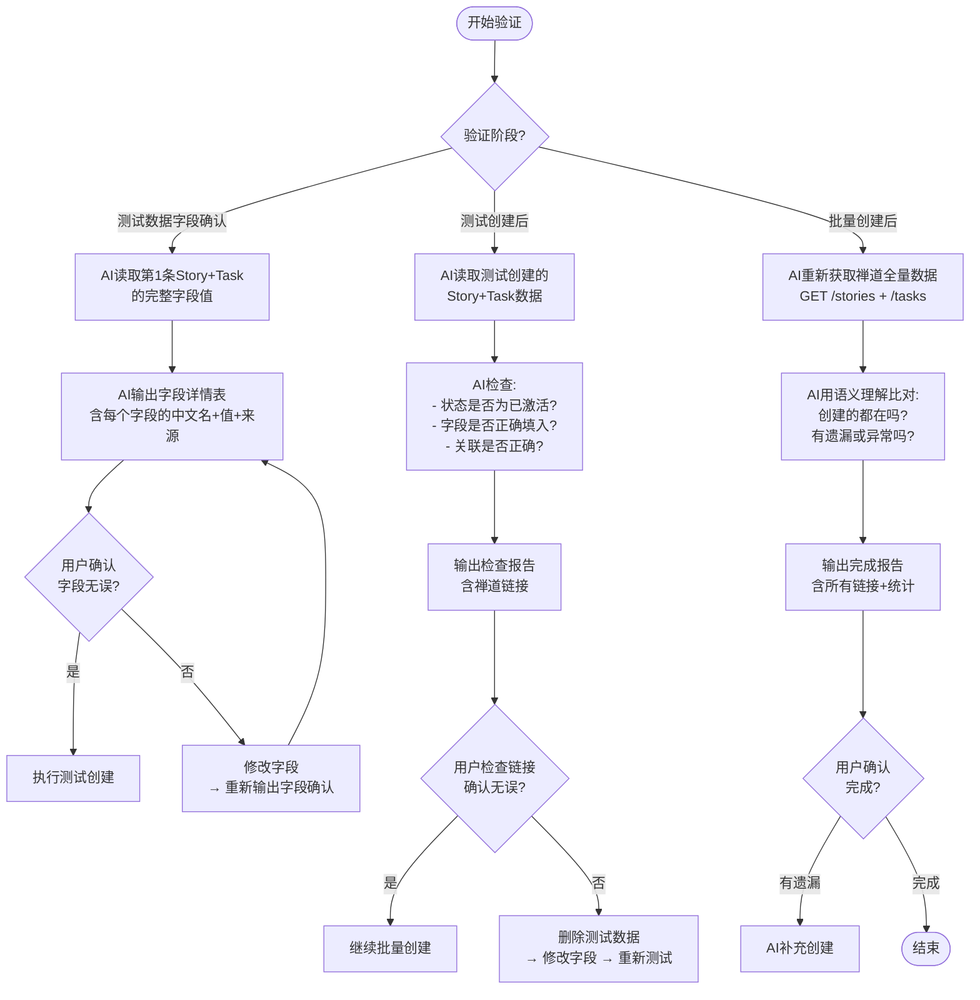

# 规则-验证检查

> **用途**：创建前后的验证检查，AI分析结果并输出检查报告，用户确认
> **加载时机**：测试数据字段确认（步骤4.5）、测试创建后（步骤5）和批量创建后（步骤6）

---

## 验证流程



---

## 测试数据字段确认（步骤4.5）

> **在执行测试创建之前，必须先输出第1条Story+Task的完整字段值供用户确认。**
> 用户确认字段无误后，才执行 `create test` 命令。
> **同时必须输出"字段补全记录表"**（见 `数据映射.md` 字段补全记录章节），让用户核查所有人工补全的内容。

### AI操作

1. 从创建数据JSON中读取第1条Story及其下的Task
2. 输出字段详情表（中文字段名 + 实际值 + 值来源）
3. **输出"字段补全记录表"**（汇总本次会话中所有询问用户后补全的字段）
4. 用 AskUserQuestion 询问用户是否确认（字段+补全记录都要确认）
5. 用户确认后才执行测试创建

### AI输出示例

```
===== 第1条测试数据字段确认 =====

【Story】
  标题:     JMBOS：智慧制造规划清单-条件筛选
  描述:     JMBOS
           智慧制造规划清单条件筛选功能
  产品ID:   240 (PMS)
  模块ID:   2539 (项目规划) ← 来源: 来源数据模块列"项目规划"匹配
  指派人:   <账号> ← 来源: 配置文件默认（用户确认）
  计划ID:   459 (V1.0项目管理系统) ← 来源: API动态获取
  执行ID:   1231 (系统开发) ← 来源: 用户选择
  优先级:   3

【Task #1】
  名称:     JMBOS：智慧制造规划清单-条件筛选：规划年度、统计范围筛选
  关联Story: (自动关联上方Story)
  模块ID:   2539 (项目规划)
  指派人:   <开发者A 账号> ← 来源: 来源数据指派人列"开发者A"→反向提取账号
  类型:     devel
  预计开始: 2026-07-01 ← 来源: 来源数据开始时间列
  截止日期: 2026-07-15 ← 来源: 来源数据截止时间列
  预计工时: 4小时

===== 字段补全记录表（共2项人工补全）=====
| # | 影响范围 | 缺失字段 | 来源数据原值 | 用户回答 | 应用方式 |
| 1 | 行15 Task | 指派人 | 开发者A | W00296(开发者A) | Task指派给W00296 |
| 2 | 行18 Task | 开始时间 | (空) | 2026-07-01 | Task用此日期 |

（若无任何人工补全，输出"本次无字段补全记录"）
```

### 用户确认方式

用 AskUserQuestion 询问，选项如：
- "确认无误（字段+补全记录都对），执行测试创建"
- "有问题，需要修正"

### 确认通过后

逐条调用创建 API（Story 三连：`POST /stories` → `/review` → `/assign`，再 `POST /executions/{id}/tasks` 创建其下任务，见 rules/API操作.md）

### 确认不通过时

1. 根据用户反馈修改字段或补全记录
2. 重新输出字段详情表 + 字段补全记录表
3. 用户再次确认

---

## 测试创建验证（步骤5）

测试创建只创建第1条Story + 其下的任务。AI应检查：

### AI检查项

| 检查点 | 期望结果 |
|--------|---------|
| Story状态 | **active**（已激活，非草稿） |
| 标题格式 | 符合命名规范 |
| 关联执行 | 正确（之前选择的执行ID） |
| 指派人 | 正确 |
| 模块 | 正确 |
| Task名称 | 与来源数据一致 |
| Task关联Story | 正确关联 |

### AI输出示例

```
===== 测试创建检查结果 =====

✅ Story #13998 "JPM：测试-审批表单"
  - 状态: active ✓
  - 指派人: <指派人账号> ✓
  - 关联执行: 系统开发(ID=1231) ✓
  - 链接: https://zentao.jomoo.com/zentaopms/www/story-view-13998.html

✅ Task #22992 "JPM：测试-审批表单：表单设计"
  - 关联Story: #13998 ✓
  - 链接: https://zentao.jomoo.com/zentaopms/www/task-view-22992.html

请打开链接检查，确认无误后继续批量创建。
```

### 验证通过后

按已确认清单逐条调用创建 API（同上，不再逐条确认）

### 验证不通过时

1. AI删除测试数据（先验证创建人）
2. 修改字段
3. 重新预览确认
4. 重新测试创建

---

## 批量创建验证（步骤6）

批量完成后，AI重新获取禅道数据做完整性检查。

### AI比对方式

AI获取产品下所有Story和执行下所有Task，与来源数据期望数据做**语义比对**：

- 来源数据中的每条数据，是否都能在禅道中找到匹配项？
- 是否有缺失的Story？
- 是否有缺失的Task？

### AI输出示例

```
===== 批量创建完成报告 =====

✅ 成功创建: 7 个研发需求, 13 个任务

所有链接:
  Story #13998: https://zentao.jomoo.com/zentaopms/www/story-view-13998.html
  Story #13999: https://zentao.jomoo.com/zentaopms/www/story-view-13999.html
  ...

  Task #22992: https://zentao.jomoo.com/zentaopms/www/task-view-22992.html
  Task #22993: https://zentao.jomoo.com/zentaopms/www/task-view-22993.html
  ...

AI完整性检查:
  ✅ 来源数据共 7 个需求 → 禅道 7 个 (全部匹配)
  ✅ 来源数据共 13 个任务 → 禅道 13 个 (全部匹配)

请确认是否全部正确？如有遗漏或异常请指出。
```

---

## 操作命令

| 操作 | 调用 |
|------|------|
| 创建需求 | `POST /stories` → `POST /stories/{id}/review` → `POST /stories/{id}/assign` |
| 创建任务 | `POST /executions/{id}/tasks` |
| 获取产品所有需求 | `GET /api.php/v1/products/{id}/stories` |
| 获取执行所有任务 | `GET /api.php/v1/executions/{id}/tasks` |

---

## 安全规则

- 测试数据不满足要求时：**必须先删除**再重新创建
- 删除前必须验证创建人（通过API检查 `actions.opened.actor`）
- 只能删除当前用户创建的数据
- 批量创建完成后AI做语义比对检查，输出报告给用户确认
